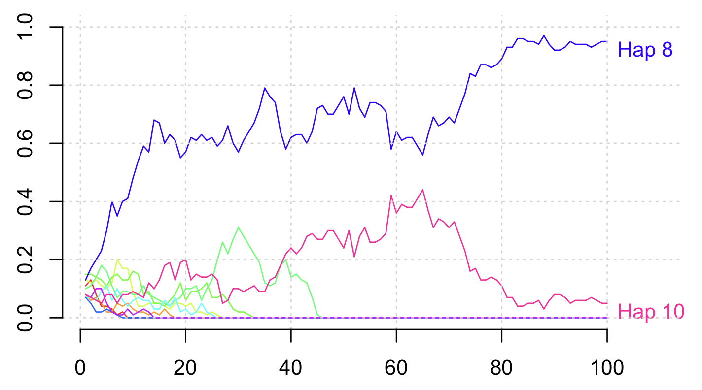

# How do frequencies evolve?

If you look at the 'before' and 'after' haplotypes, you'll probably see some features:

* many variants are no longer polymorphic - the other alleles have been 'lost' or have 'fixed'
* many of the remaining alleles are either rare or common.

But how do these evolve over time? To see that let's write some quick functions to compute the haplotype and variant
frequencies across time:

```
compute.haplotype.frequencies <- function( population, haplotypes ) {
  # We compute the frequency of each haplotype at each generation
  result = matrix(
	nrow = G,
	ncol = H,
	dimnames = list(
	  sprintf( "generation=%d", 1:G ),
	  sprintf( "haplotype=%d", 1:H )
	)
  )
  for( i in 1:G ) {
	currentGeneration = population[i,]
	result[i,] = sapply( 1:H, function(h) { length( which( currentGeneration == h )) } ) / N
  }
  return( result )
}
```

And to plot them:
```
# Utility function to plot an empty canvas
blank.plot <- function( xlim = c( 0, 1 ), ylim = c( 0, 1 ), xlab = "", ylab = "" ) {
  plot(
	0, 0,
	xlab = xlab,
	xlim = xlim, ylab = ylab, ylim = ylim,
	col = 'white', # draw points white
	bty = 'n',     # no border
	xaxt = 'n',    # no x axis
	yaxt = 'n'    # no y axis
  )
}


plot.haplotype.frequencies <- function( frequencies ) {
	blank.plot( xlim = c( 1, G*1.1 ), ylim = c( 0, 1 ), xlab = "Generations", ylab = "Haplotype frequencies")
	palette = rainbow( H )
	for( i in 1:H ) {
	points( 1:G, frequencies[,i], col = palette[i], type = 'l' )
	if( frequencies[G,i] > 0 ) {
		text( G*1.02, frequencies[G,i], sprintf( "Hap %d", i ), adj = c( 0, 1 ), xpd = NA, col = palette[i] )
	}
	}
	grid()
	axis(1)
	axis(2)
}
```

And run it:
```r
frequencies = compute.haplotype.frequencies( population, haplotypes )
plot.haplotype.frequencies( frequencies )
```

You might see something a bit like this:


Here haplotypes 8 and 10 are present in the population at the end - the others have been lost!

But of course yours will look different - it's a stochastic simulation.

**Question.** What is happening to the haplotype frequencies over time?  What is causing this?

:::tip Terminology

The effects of random inheritance on the evolution of haplotypes are also known as *genetic drift*.

:::
