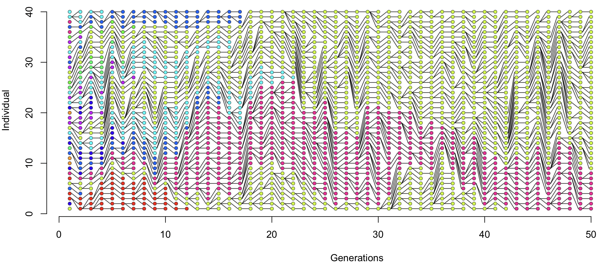

# Tracking inheritance

So far we've been thinking about the patterns of haplotypes - frequencies, LD and so on.

But what about the underlying patterns of inheritance?  Let's add something now to track the 'genealogy'.

## Tracking parents

Currently our `evolve()` function looks like this:

<div className="r-py-columns">

```r
evolve <- function( currentGeneration ) {
  parents = sample( 1:N, size = N, replace = TRUE )
  return( currentGeneration[parents] )
}
```
```python
def evolve(current_generation):
  parents = np.random.choice(N, size=N, replace=True)
  return current_generation[parents]
```
</div>

Let's change this to something *even simpler* that tracks the parents instead:
<div className="r-py-columns">

```r
choose.parents <- function( N ) {
  parents = sample( 1:N, size = N, replace = TRUE )
  return( parents )
}
```
```python
def choose_parents( N ):
  parents = np.random.choice(N, size=N, replace=True)
  return parents
```
</div>

To use this in our simulation we need to update the code to track it.  Let's create another matrix to track the parents.  (We'll also turn down the simulation size so we can plot it later:

<div className="r-py-columns">

```r
N = 40 # number of individuals
G = 50 # number of generations
population = matrix(
  NA, nrow = G, ncol = N,
  dimnames = list(
    sprintf( "generation=%d", 1:G ),
    sprintf( "individual=%d", 1:N )
  )
)

# Add an empty `parents` matrix too
parents = population
```
```python

N = 40  # number of individuals
G = 50  # number of generations

population = np.empty((G, N), dtype=int)
# Add an empty `parents` matrix too
parents    = np.empty_like(population)
```
</div>

We'll initialise the population too:

<div className="r-py-columns">

```r
population[1,] = sample( 1:H, size = N, replace = TRUE )
```
```python
population[0] = np.random.choice(H, size=N, replace=True)
```
</div>

Finally, let's change our simulation so it tracks the parents:

```r
for( generation in 2:G ) {
  my_parents = choose.parents(N)
  population[generation,] = population[ generation-1, my_parents ]
  # Track the parents!
  parents[generation,] = my_parents
}

```

Let's check that still works:
<div className="r-py-columns">

```r
layout( matrix( 1:2, nrow = 2 ) )
par( mar = c( 3, 3, 1, 1 ))
plot.haplotypes( haplotypes[population[1,],])
plot.haplotypes( haplotypes[population[G,],])
```
```python
fig, axes = plt.subplots(ncols=2, figsize=(10, 4))

ax = plot_haplotypes(haplotypes[population[0]], "Gen 0", axes[0])
ax = plot_haplotypes(haplotypes[population[G-1]], f"Gen {G-1}", axes[1])
```
</div>

Excellent!  What about plotting the inheritance patterns?

OK let's make a grid of all the individuals over time.

<div className="r-py-columns">

```r
plot.population = function( population ) {
  library( dplyr )
  long_form = (
    expand.grid( individual = 1:N, generation = 1:G )
    %>% dplyr::group_by( individual, generation )
    %>% dplyr::mutate( haplotype = population[generation, individual] )
  )
  
  palette = rainbow( H )
  plot(
    long_form$generation,
    long_form$individual,
    xlim = c ( 1, G*1.1 ),                 # to match haplotype
    bg  = palette[ long_form$haplotype ],  # fill colour
    pch = 22,                              # filled squares
    cex = 0.5,                             # small size
    col = NA,                              # no outline on shapes
    xlab = "Generations",
    ylab = "Individual",
    bty = 'n'                              # no border
  )
}

plot.population( population )
```
</div>

And now we could add the lines of inheritance:
<div className="r-py-columns">

```r
  segments(
    x0 = 1:(G-1), x1 = 2:G,
    y0 = parents[2:G,], y1 = rep( 1:N, G-1 )
  )
```

**Argh!**  To make this understandable we need to somehow sort the columns in each generation so that the children are
nearer the parents.

This is a bit fiddly to do, but luckily we've got you covered:

```r
source( "https://raw.githubusercontent.com/chg-training/chg-training-resources/refs/heads/main/docs/population_genetics/simulation/plot_population_with_tree.R" )

plot.population.with.tree( population, parents )
```
</div>



:::tip Note

If you think about this plot a bit, it's showing how **changes in haplotype frequency** and **inheritance** are really
two sides of the same coin (at least in populations that stay roughly the same size).  For example, haplotypes that
increase in frequency do so because lots of individuals inherit the same allele.  

In these pages we've explored **random genetic drift**, which is one effect of these inheritance patterns.  Of course, another is **natural selection** where the number of offspring carrying each haplotype might systematically depend on the haplotype itself.

:::
