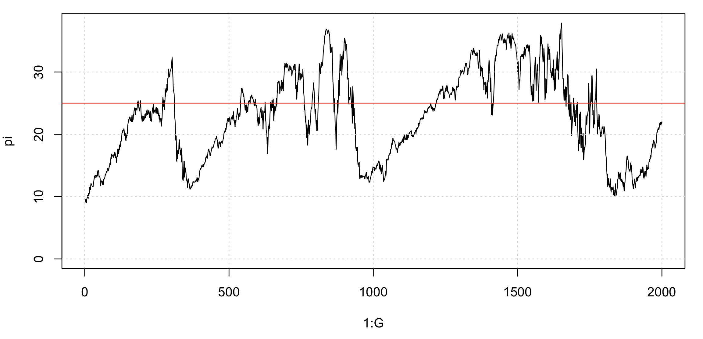

# Mutation vs drift

The simulation we just did illustrates the fate of mutations under genetic drift.

If mutations don't have any selective forces on them - so they are **neutral** - they behave as follows.  They are created when they mutate, drift around in frequency for some time, and ultimately are either lost or fix in the population.

If you watch your population for a while, though, you'll see it never seems to lose all its polymorphism.  Many of the
original variants have been lost, but new ones have popped up to replace them.  And you'll probably see that the total number of haplotypes in your population probably also stays relative stable - maybe around 60-70 if you used the same parameters as me.

This means **congratulations** are in order.  Your population is showing **mutation-drift balance**!  The rate at which
mutations are being lost due to drift, becomes balanced with the rate at which new mutations are being added due to
mutation.  The result is a population that retains polymorphism through time (but the polymorphisms are constantly
changing.)

To quantify this let's look at the basic measure of diversity in the population - **nucleotide diversity**, or the
average number of pairwise differences between haplotypes.  It is often denoted $\pi$.  Here is a function that computes
it for our population:

```r
nucleotide.diversity <- function( population ) {
	N = length( population )
	count.variant.alleles <- function( population ) {
		population_haplotypes = haplotypes[population,]
		return( colSums( population_haplotypes > 0 ))
	}

	f = count.variant.alleles( population )
	return( sum( f * ( N - f )) / (N * (N-1) / 2) )
}
```

And then we could compute it across generations:
```r
pi = sapply(
	1:G,
	function(g) {  nucleotide.diversity( population[g,] ) }
)

plot( 1:G, pi, type = 'l', ylim = c( 0, max(pi, na.rm = T )) )
grid()
```

This can be compared to a **famous result** which says that the *expected* nucleotide diversity is equal to twice the
effective population size, times the mutation rate:

$$
E(\pi) = 2\times N\times \mu
$$

Let's add that expectation on the graph:
```r
abline( a = 2 * N * mutation_rate, b = 0, col = 'red' )
```

You will probably see that it is not especially similar!  Over 2,000 generations, mine looks like this:



The expected value is just that - an *expected* or *average* value.  It is what you would expect to see, on average, if
you ran the simulation many times over - or if you ran it for a very long time and looked at the long-run average.
There's quite a bit of random drift in our $N=250$ population so the estimate varies quite widely around the average.
So our actual population might not be particularly close to it in this simulation.

:::tip Note
The expectation formally applies under an 'infinite sites model'.

In our simulations, the same base can mutate more than once - we only have 5,000 sites to work with - so we may get slightly less diversity than the theoretical expectation.

:::

:::caution Warning

Before getting carried away interpreting this, there are a few things to be aware of.

First, the population size here is - of course - *much much* lower than most real population sizes.  When thinking about
real populations it's common to think as if they behaved a bit like this simple model, but using an 'effective'
population size that is substantially smaller than the true, census population size.  For example, in many broad human populations the effective population size is often taken to be maybe tens of thousands (even though the total population size is much larger).  

Still - our simulation only has a few *hundred* individuals and so drift is very strong indeed.

Second - the mutation rate here is **much, much** higher than most real mutation rates.  For example in humans the
mutation rate is thought to be around $1\times 10^-8$ mutations per base per generation (although this depends on parental age).  So it would be around $5\times 10^-5$ in a 5kb region.  In malaria parasites, the mutation rate is estimated to be [around $5\times 10^-10$](https://doi.org/10.1371/journal.pgen.1004812) SNPs per base per erythrocyte cycle (although there may be many cycles between transmission events.)

Our simulation may be more like species that mutate quickly - like RNA viruses - the rate is [much higher](https://www.sciencedirect.com/science/chapter/monograph/pii/B9780123849397100031) - say around $10^{-3}$ to $10^{-5}$ per base per generation, which would indeed translate to quite a high rate across around 5kb region.

These differences definitely matter **quantitatively**.  Qualitatively, at least at the level of this tutorial, they matter less because our simple Wright-Fisher populations evolve in much the same way regardless of population size - as long as we scale time appropriately.

:::