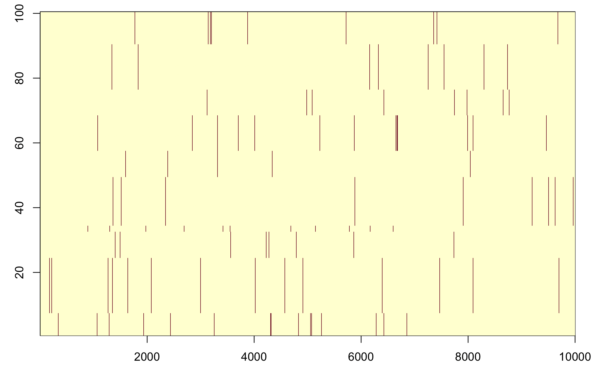

# Sorting haplotypes

Let's immediately make a couple of tweaks here. First, it would be nicer to sort the haplotypes before plotting.
Second, so we can easily compare different population sizes, let's just have it plot the first 100 samples.  Here is a
function that can do that:

```r
plot.haplotypes <- function(
    haplotypes,
    sort = FALSE,
    number_to_plot = N
) {
  # We just plot the first n
  n = min(number_to_plot, nrow(haplotypes))
  haplotypes = haplotypes[1:n,]
  if( sort ) {
	# We use 'hierarchical clustering' to order the haplotypes
	# We are here using 'manhattan' distance, i.e. the sum of differences
	# between pairs of haplotypes
    order = hclust(
		dist( haplotypes, method = "manhattan" )
	)$order
  } else {
    order = 1:nrow(haplotypes)
  }
  image(
    t(haplotypes[order,]),
    x = 1:ncol(haplotypes),
    y = 1:nrow(haplotypes),
    xlab = "variant",
    ylab = "haplotype"
  )
}
```

Run it like this:
```r
plot.haplotypes( haplotypes[population[1,],], sort = TRUE, number_to_plot = 100 )
```



Ok this looks nicer.
