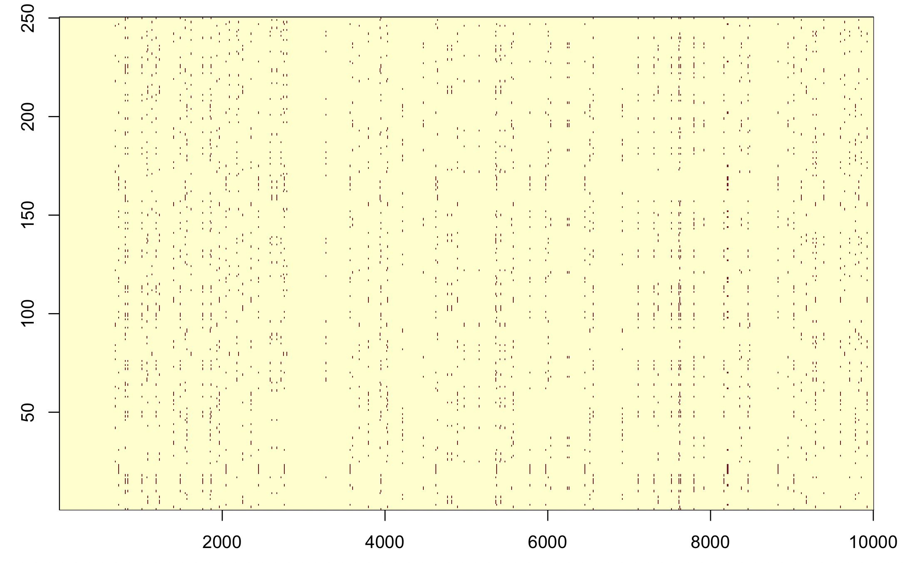

# Starting over

Let's build our simulation again, and this time let's give ourselves a long stretch of chromosome to work over - say
5kb. As before we'll initialise the simulation with a set of 10 possible haplotypes:

```r
L = 5000
H = 10
haplotypes    = matrix( NA, nrow = H, ncol = L )
haplotypes[,] = rbinom( n = H*L, size = 1, prob = 0.01 )
```

Now let's pick a population size and initialise the simulation - for a first go I will pick 250 samples over 1000
generations.

```r
N = 250 # number of individuals
G = 1000 # number of generations
population = matrix(
  NA, nrow = G, ncol = N,
  dimnames = list(
    sprintf( "generation=%d", 1:G ),
    sprintf( "individual=%d", 1:N )
  )
)
```

And let's initialise our population:
```r
population[1,] = sample( 1:nrow(haplotypes), N, replace = TRUE )
```

You could also pick larger sample sizes above if you want - especially if you have a fast computer.  This simulation is pretty slow. (I'd advise not to go above around 1000 though.)

As before we can plot the haplotypes in our population:
```r
plot.haplotypes( haplotypes[population[1,],] )
```

You might see something like:



Cool!  If a bit boring.  Let's try [sorting them](./sorting.md).

:::caution Caution

If you get a message about 'figure margins too large' - you may need to try
```r
par( mfrow = c( 1, 1 ))
```
first.  This turns off the multi-panel plot we did.

:::
