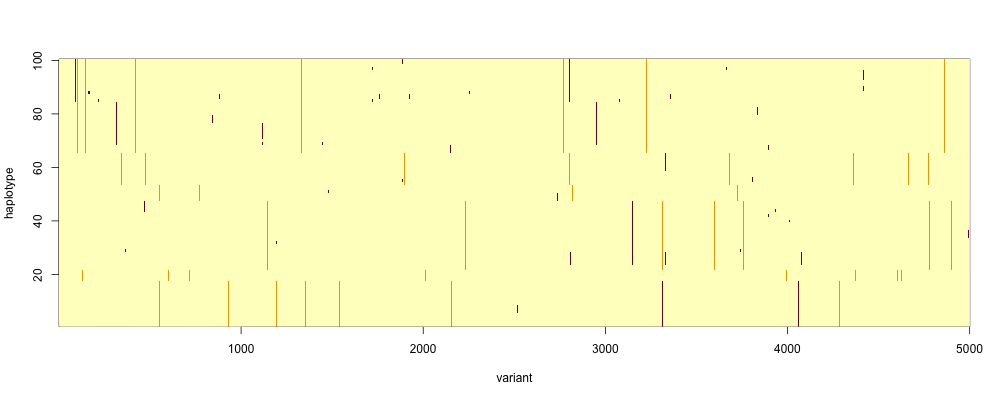

# Watching it run

To see the behaviour of our sim, let's store snapshots on the filesystem.  We'll make a new folder for this
now.

:::tip Note

We're about to store files, so this is a good time to move to a directory of your choice.  Perhaps you want to create a `popgen` folder and `cd` into it?

:::

First make sure you are in the folder you want to be in for this practical, and let's make a place to store output
images.  I'll call it 'simulation' but, for later reference, will also keep the population size and other parameters in
the filename:

```r
mutation_rate = 0.1
image_dir = sprintf( "simulation/N=%d,L=%d,mu=%.3f", N, L, mutation_rate )

dir.create( image_dir, recursive = TRUE,  showWarnings = FALSE )
dir.create( sprintf( "%s/haplotypes", image_dir), recursive = TRUE,  showWarnings = FALSE )
```

Here is the useful `echo()` function to print messages:
```r
echo = function( message, ... ) {
  cat( sprintf( message, ... ))
}
```

Here's the complete program.  This time we'll start with a not-very-diverse set of haplotypes:
```r
L = 5000                      # number of sites
H = highest.haplotype = 10    # number of haplotypes at start
N = 250                       # number of individuals in the population
G = 2000                      # number of generations
mutation_rate = 0.05          # mutation rate per locus per generation

image_dir = sprintf( "simulation/N=%d,L=%d,mu=%.3f", N, L, mutation_rate )
dir.create( sprintf( "%s/haplotypes", image_dir), recursive = TRUE,  showWarnings = FALSE )

# initialise haplotypes
haplotypes       = matrix( NA, nrow = 25000, ncol = L )
haplotypes[1:H,] = rbinom( n = H*L, size = 1, prob = 0.001 )

# initialise population
population = matrix(
  NA, nrow = G, ncol = N,
  dimnames = list(
    sprintf( "generation=%d", 1:G ),
    sprintf( "individual=%d", 1:N )
  )
)
population[1,] = sample( 1:H, N, replace = TRUE )

# Evolve population!
for( generation in 2:G ) {
  echo( "++ generation %d of %d...\n", generation, G )

  # Evolve the population, now with mutations
  population[generation,] = evolve( population[generation-1,], mutation_rate )

  # Let's just plot every 5th generation to avoid too many plots!
  if( generation %% 5 == 1 ) {
    filename = sprintf( "%s/haplotypes/generation_%04d.png", image_dir, generation )
    echo( "++ Plotting generation %d to \"%s\"...\n", generation, filename )
    echo(
      "   (%d different haplotypes seen so far, %d still present.)\n",
      highest.haplotype,
      length( unique( population[generation, ]))
    )
    png( file = filename, width = 1000, height = 400 )
    plot.haplotypes( haplotypes[population[generation,],], sort = TRUE )
    dev.off()
  
    # !! IMPORTANT!! Use gc() to return memory to operating system!
	  # Without this you may use up all your RAM
    gc()
  }

  if( highest.haplotype > nrow( haplotypes )) {
	echo( "++ Uh-oh!  I ran out of haplotype storage.  Quitting the simulation." )
	break ;
  }
}
```

This will take a while to run.  Leave it running while it goes.

While it's running, point your operating system's image viewer at the output directory (the one in `image_dir` above) to
have a look at what's happening.  You should see your population evolving in real time!  

:::tip Question
Can you see the new mutations?  (They'll be a different colour).

You should see some of these arising and drifting around in frequency.  What's happening to the original mutations?

:::

For example after 66 generations, mine looks like this:



:::warning Warning

Remember we have [sorted](./sorting.md) these haplotypes - that's why similar ones appear together in the plot.

:::

