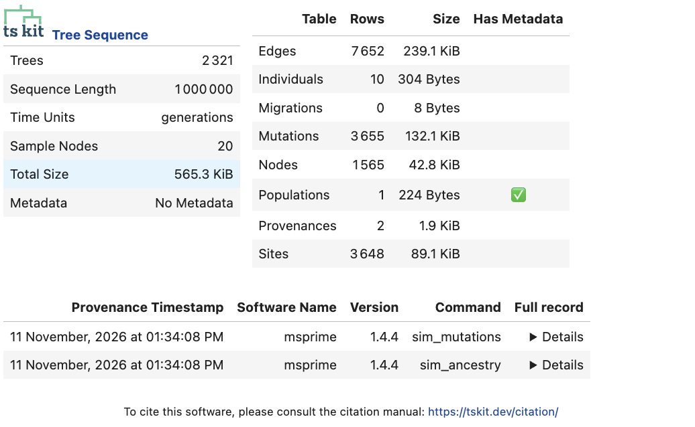

# Backward-time simulation

It's a pain to track the whole population, when all we need is the tree of a much smaller
set of sampled genomes. There's a neat trick that works here *if evolution is neutral*.
Instead of simulating forwards in time, we can take our sample of (say) 10 genomes from
the current day, and simulate *backward in time*. For example, if we know that the samples
are from a large population of 40,000 haploid (20_000 diploid) individuals, and children
trace back to parents that are a random sample from that population, then the chance any
two lineages will trace back to a common ancestor in the previous generation is 1 in 40,000.

In effect, this is running the Wright-Fisher model backwards in time, assuming that
parents are "chosen at random" (i.e. there is random mating). You can probably imagine how
this can be used to build a tree. Moreover, this appraoch makes it obvious when to stop simulating: when all the samples have "fully coalesced" (i.e. there is a single MRCA in every local tree).

We won't build a backward-time simulator in this practical. Instead, we'll use
`msprime.sim_ancestry()`, which is a very capable backward simulator.
We'll also switch to a diploid model, to mimic humans.

This is quite a big population size, and a fairly large chunk of chromosome, so it might take a minute or two to simulate:

```python
ts = msprime.sim_ancestry(
    10,
    population_size=20_000,  # equal to 40_000 haploids
    recombination_rate=RHO,
    sequence_length=1e6,
    model=msprime.DiscreteTimeWrightFisher(),
    ploidy=2,   # can be omitted: 2 is the default
)
ts = msprime.sim_mutations(ts, rate=1.3e-8)
```

In a Jupyter notebook, we can display the tree sequence to show a summary

```python
display(ts)
```



**Question.** How many trees have we simulated above? (note that in your case you might get a different number, as we haven't set a random seed)

As we set the population size to the "effective population size" estimated for humans 
(15-20 thousand diploids, or 30-40 thousand haploids), and we used a human-like mutation
rate, we might expect the pairwise genetic diversity to roughly match that seen in humans 
(which you might remember is 1 in 1000, or 0.001)

```python
print("π =", ts.diversity())
```

```
0.0010846444444444882
```

Hooray!

Actually, there's a way to make this simulation lightning-fast, and that's by using and 
alternative model to the Wright-Fisher one. Instead of modelling discrete generations
backwards in time, we can simply jump straight to the next coalescence (or recombination) event, if we know the expected distribution of waiting times. That's the default model
in _msprime_ (it's called the "StandardCoalescent" or "hudson" model), and it gives almost exactly the same results:

```python
ts = msprime.sim_ancestry(
    10,
    population_size=20_000,  # equal to 40_000 haploids
    recombination_rate=RHO,
    sequence_length=1e6,
    model=msprime.StandardCoalescent(),  # or just omit this line, as its the default
    ploidy=2,  # can be omitted: 2 is the default
)
ts = msprime.sim_mutations(ts, rate=1.3e-8)
print("π =", ts.diversity())
print(ts.num_trees, "trees")
```

```
π = 0.001067963157894743
2444 trees
```

Probably the best idea is to run the `DiscreteTimeWrightFisher()` model in the recent
past, then switch to the `StandardCoalescent()` more than (say) 20 generations ago.

```python
ts = msprime.sim_ancestry(
    10,
    population_size=20_000,  # equal to 40_000 haploids
    recombination_rate=RHO,
    sequence_length=1e6,
    model=[
        msprime.DiscreteTimeWrightFisher(duration=20),
        msprime.StandardCoalescent(),
    ],
    ploidy=2,  # can be omitted: 2 is the default
)
ts = msprime.sim_mutations(ts, rate=1.3e-8)
print("π =", ts.diversity())
print(ts.num_trees, "trees")
```

```
π = 0.0010691368421052708
2492 trees
```


The _msprime_ software is incredibly flexible and can be used to simulate different 
demographies (e.g. semi-isolated populations, population size changes and bottlenecks etc.),
as well as processes like gene conversion. 

Perhaps the most powerful thing, however, is to combine msprime with a forward simulator...