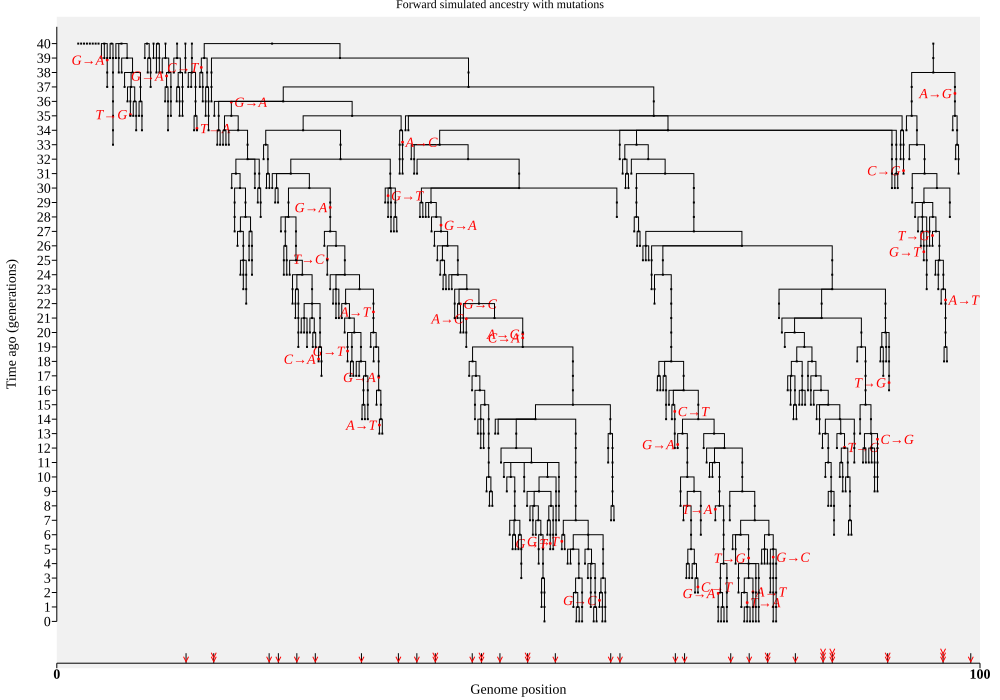
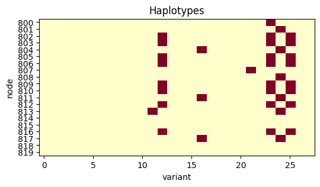

# Adding mutations

By definition, if mutations are neutral, they have no effect on which genetic
sequences are passed on. That means we can add neutral mutations on to an
already-simulated ancestry. If the vast majority of mutations are neutral
(which is thought to be the case), that has the huge advantage that we don't
need to keep track of them during the ancestry simulation itself. This is one
of several advantages to recording the paths of inheritance.

The easiest way to add mutations to a tree sequence is to pass it to the
`msprime.sim_mutations()` function. That can use complicated
[mutational models](https://tskit.dev/msprime/docs/stable/mutations.html)
but by default it simply adds single nucleotide mutations (i.e. A, C, G, and T)
at random along the simulated chromosome, in proportion to the branch length.
This is called the Jukes-Cantor model, and is much more realistic than our previous method, which just set random 1s and 0s. Using it is as simple as:

```python
import msprime
mutated_ts = msprime.sim_mutations(ts, rate=5e-4, random_seed=None)
```

**Question.** why might the mutations in your simulation differ from those
of your neighbours? How could you make them the same?

You may not be surprised to learn that the *mutations* are stored in
tables too, one row per mutation. Each mutation occurs at a specific
*site* along the genome, and the sites too are stored as tables (one row
per site). You can see how many have been added to the tree sequence like this:

```python
print(mutated_ts.num_mutations, "mutations added at", mutated_ts.num_sites, "sites")
```

**Question.** why might there be more mutations than sites?

If we plot out the ancestry, we can see the mutations in red, and the sites
highlighted along the length of the genome at the bottom. By default `draw_svg()`
labels mutations by their row number, but here we've constructed nicer labels
that show the original DNA letter and the one it's mutated to:

```python
mut_labels = {
    m.id: f"{m.inherited_state}→{m.derived_state}"
    for m in mutated_ts.mutations()
}
mutated_ts.draw_svg(
    size=(1000, 700), title="Forward simulation with mutations",
    node_labels={}, mutation_labels=mut_labels,
    symbol_size=2, y_axis=True,
)
```



Now that we have mutations, we can also figure out the haplotypes of any
particular node. If (say) a mutation occurs from `T` to `C` in the ancestry
of a few samples, those samples will have `C`, and the rest will have `T`.

When simulating, we set each node's `flags` value to `NODE_IS_SAMPLE`. That
tells _tskit_ to treat all nodes in the simulation as *sample nodes*
(i.e. focal nodes whose genome we might want to examine).
To pick all 20 sample nodes in the current day we can use the `ts.samples()` method,
which allows us to specify a time (otherwise it returns all the sample node IDs)


```python
current_node_ids = mutated_ts.samples(time=0)
```

The `alignments()` method prints out the full sequence for a set of nodes.
Note that we have only simulated an ancestral DNA letter for the sites
where we have placed a mutation, so many of the letters in the sequence
will be unknown. For visual clarity, we have chosen to represent this
missing information by an underscore, rather than the more conventional
letter "N".

```python
print("== Alignments ==")
sequences = mutated_ts.alignments(samples=current_node_ids, missing_data_character="_")
for i, seq in enumerate(sequences):
    print("node", current_node_ids[i], "=", seq)
```

If we want to skip the unmutated sites, we can use the `.haplotypes()` method (but note
that the haplotypes will therefore not be 100 letters long any more)

```python
print("== Condensed haplotypes ==")
sequences = mutated_ts.haplotypes(samples=current_node_ids)
for i, seq in enumerate(sequences):
    print("node", current_node_ids[i], "=", seq)
```

You should get something like this:

```
== Alignments ==
node 800 = ______________A__G_____GA_C_C____A___G_C_T___TA_A__T__A_____GT_____GG____G_C_G__C__AT_____C_____G__A
node 801 = ______________A__G_____GA_C_C____A___G_C_T___TA_A__T__A_____GT_____GG____G_C_G__C__GG_____C_____G__A
node 802 = ______________A__G_____GA_C_C____A___G_C_T___TA_G__T__A_____GT_____GG____G_C_G__C__AT_____A_____G__A
node 803 = ______________A__G_____GA_C_C____A___G_C_T___TA_G__T__A_____GT_____GG____G_C_G__C__AT_____A_____G__A
node 804 = ______________A__G_____GA_C_C____A___G_C_T___TA_A__T__A_____GA_____GG____G_C_G__C__GG_____C_____G__A
node 805 = ______________A__G_____GA_C_C____A___G_C_T___TA_G__T__A_____GT_____GG____G_C_G__C__AT_____A_____G__A
node 806 = ______________A__G_____GA_C_C____A___G_C_T___TA_G__T__A_____GT_____GG____G_C_G__C__AT_____A_____G__A
node 807 = ______________A__G_____GA_C_C____A___G_C_T___TA_A__T__A_____GT_____GG____G_C_C__C__GT_____C_____G__A
node 808 = ______________A__G_____GA_C_C____A___G_C_T___TA_A__T__A_____GT_____GG____G_C_G__C__GG_____C_____G__A
node 809 = ______________A__G_____GA_C_C____A___G_C_T___TA_G__T__A_____GT_____GG____G_C_G__C__AT_____A_____G__A
node 810 = ______________A__G_____GA_C_C____A___G_C_T___TA_G__T__A_____GT_____GG____G_C_G__C__AT_____A_____G__A
node 811 = ______________A__G_____GA_C_C____A___G_C_T___TA_A__T__A_____GA_____GG____G_C_G__C__GG_____C_____G__A
node 812 = ______________A__G_____GA_C_C____A___G_C_T___TA_G__T__A_____GT_____GG____G_C_G__C__AT_____A_____G__A
node 813 = ______________A__G_____GA_C_C____A___G_C_T___TT_A__T__A_____GT_____GG____G_C_G__C__GG_____C_____G__A
node 814 = ______________A__G_____GA_C_C____A___G_C_T___TA_A__T__A_____GT_____GG____G_C_G__C__GT_____C_____G__A
node 815 = ______________A__G_____GA_C_C____A___G_C_T___TA_A__T__A_____GT_____GG____G_C_G__C__GT_____C_____G__A
node 816 = ______________A__G_____GA_C_C____A___G_C_T___TA_G__T__A_____GT_____GG____G_C_G__C__AT_____A_____G__A
node 817 = ______________A__G_____GA_C_C____A___G_C_T___TA_A__T__A_____GA_____GG____G_C_G__C__GG_____C_____G__A
node 818 = ______________A__G_____GA_C_C____A___G_C_T___TA_A__T__A_____GT_____GG____G_C_G__C__GT_____C_____G__A
node 819 = ______________A__G_____GA_C_C____A___G_C_T___TA_A__T__A_____GT_____GG____G_C_G__C__GT_____C_____G__A

== Condensed haplotypes ==
node 800 = AGGACCAGCTTAATAGTGGGCGCATCGA
node 801 = AGGACCAGCTTAATAGTGGGCGCGGCGA
node 802 = AGGACCAGCTTAGTAGTGGGCGCATAGA
node 803 = AGGACCAGCTTAGTAGTGGGCGCATAGA
node 804 = AGGACCAGCTTAATAGAGGGCGCGGCGA
node 805 = AGGACCAGCTTAGTAGTGGGCGCATAGA
node 806 = AGGACCAGCTTAGTAGTGGGCGCATAGA
node 807 = AGGACCAGCTTAATAGTGGGCCCGTCGA
node 808 = AGGACCAGCTTAATAGTGGGCGCGGCGA
node 809 = AGGACCAGCTTAGTAGTGGGCGCATAGA
node 810 = AGGACCAGCTTAGTAGTGGGCGCATAGA
node 811 = AGGACCAGCTTAATAGAGGGCGCGGCGA
node 812 = AGGACCAGCTTAGTAGTGGGCGCATAGA
node 813 = AGGACCAGCTTTATAGTGGGCGCGGCGA
node 814 = AGGACCAGCTTAATAGTGGGCGCGTCGA
node 815 = AGGACCAGCTTAATAGTGGGCGCGTCGA
node 816 = AGGACCAGCTTAGTAGTGGGCGCATAGA
node 817 = AGGACCAGCTTAATAGAGGGCGCGGCGA
node 818 = AGGACCAGCTTAATAGTGGGCGCGTCGA
node 819 = AGGACCAGCTTAATAGTGGGCGCGTCGA
```

The `ts.genotype_matrix()` method will get a numerical array of num_sites by num_nodes,
which can be used to plot the haplotype matrix. We'll need to transpose it using `.T`
to put the sites on the X axis.

**Warning**: genomes can contain millions of variable sites, so outputting the whole
`genotype_matrix` (as well as accessing `ts.alignments()` and `ts.haplotypes()`) can be
very inefficient for large datasets. Instead, in real reasearch you are encouraged to
loop over each variable site in turn, using `ts.variants()`. This avoids the need to
store enormous matrices of potentially millions or billions of entries.

```python
def plot_ts_haplotypes(ts, sample_node_ids=None, ax=None):
    if sample_node_ids is None:
        sample_node_ids = ts.samples()
    if ax is None:
        fig, ax = plt.subplots(
            1, figsize=(1/5 * ts.num_sites, len(sample_node_ids) * 1/5))

    big_matrix = ts.genotype_matrix(samples=sample_node_ids)
    ax.imshow(
        big_matrix.T,
        cmap="YlOrRd",
        vmin=0, vmax=1, aspect="auto",
        interpolation="nearest",
    )
    ax.set(
        xlabel='variant position', ylabel='node', title="Haplotypes",
        yticks=np.arange(len(sample_node_ids)), yticklabels=sample_node_ids,
        xticks=np.arange(ts.num_sites), xticklabels=ts.sites_position.astype(int),
    )
    ax.tick_params(axis="x", labelrotation=90)

plot_ts_haplotypes(mutated_ts, current_node_ids)
```



It's not very impressive yet. In particular there are a lot of blank columns.
That's because we are including all the sites where we placed mutations,
*even if they occur on lineages that went extinct*. Look at the
ancestry plot to convince yourself of this.
That's also why the haplotypes have the same letter at many of the
positions.

What we really want to do is to treat only the nodes in the current
generation as samples. To do that, we need to learn about *simplification*.


