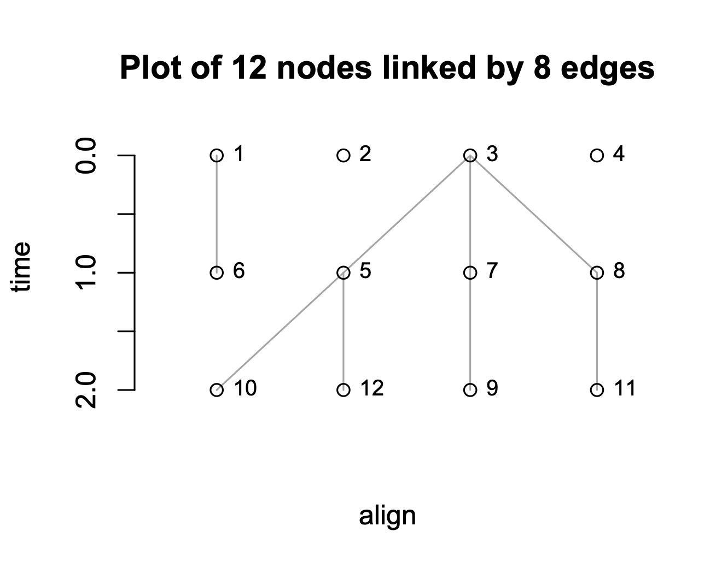
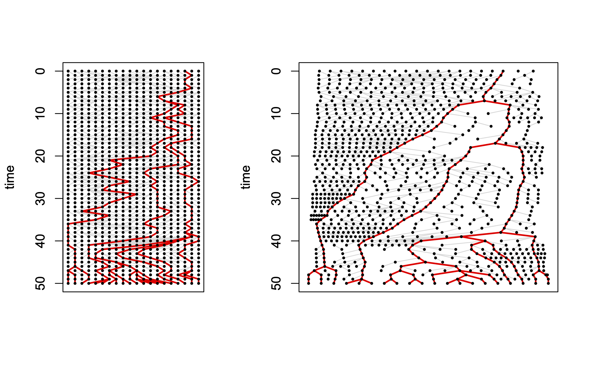
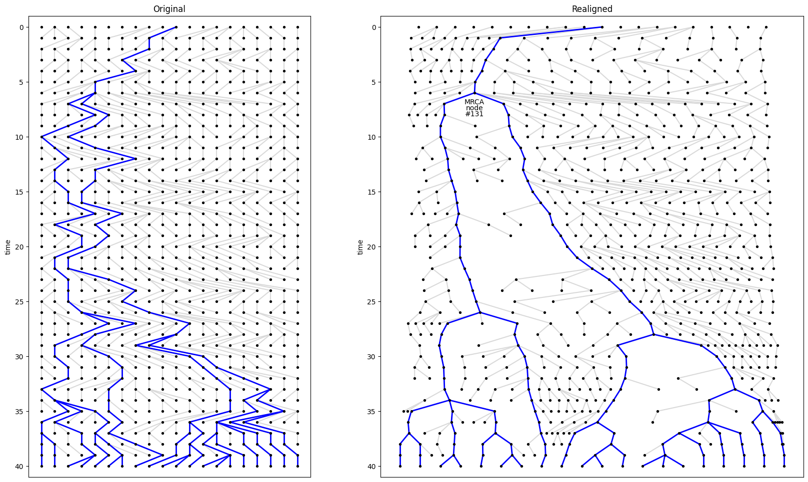

# Long-format nodes and edges

In the basic Wright Fisher model we devised in the [previous practical](../genetic_drift/)
we saved haplotypes as numbers in a matrix of _generations_ × _population_size_. However,
as we saw, it can help to use a so-called "long-format" in which individuals are saved as
rows in a long list.

So in the code below we:

* Store every "individual" as a unique numbered **node**: think of each as a row in a long-form "nodes" object. The most important value in the row is the *time* of birth (i.e the generation); for display purposes we'll also save an arbitrary *align* value, to separate the nodes when plotting.
* Record ancestry using a *pair* of numbers, the parent node ID and the child node ID. Each (parent, child) pair is known as an **edge**, and stored as a row in an "edges" object.

Note that for the moment we'll only simulate and store the _ancestry_ of individuals. 
We're not bothering to record their specific haplotypes.

Here's the code, wrapped in a single `WFsimulation()` function. By now it should look familiar; note that the R and Python code is almost line-by-line identical, other than R indexing from 1..N and Python indexing from 0..N-1.
To make the simulation repeatable, we also allow a random_seed to be specified.


<div className="r-py-columns">

```r


WFsimulation <- function(N, G, random_seed = NULL) {
    if (!is.null(random_seed)) set.seed(random_seed)
    # Allocate matrix to store N*(G+1) nodes; each node is a row
    nodes = matrix(NA, nrow=N * ( G + 1 ), ncol = 2)
    colnames(nodes) = c("align", "time")
    # Allocate matrix to store N*G edges; each edge is a row
    edges = matrix(NA_integer_, nrow=N * G, ncol = 2)
    colnames(edges) = c("parent", "child")
    
    parents = 1:N  # initial generation at time 0
    nodes[parents, ] = cbind(align = seq_len(N), time = 0)

    for (generation in 1:G) {
        children = max(parents) + seq_len(N)
        nodes[children, 'time'] = generation
        
        edges[parents, ] = cbind(
            parent=sample(parents, N, replace = TRUE ), child=children)

        # For plotting, order children by their parents' alignment position
        nodes[children, 'align'] = rank(
            nodes[edges[parents, "parent"], "align"], ties.method = "first")

        parents = children
    }
    return(list(nodes=nodes, edges=edges))
}
```
```python
import numpy as np
from scipy.stats import rankdata  # equivalent of R's rank()

def WFsimulation(N, G, random_seed=None):
    rng = np.random.default_rng(random_seed)  # make a random number generator
    # Allocate array to store N*(G+1) nodes; each node is a row
    nodes = np.empty((N * (G + 1), 2))
    ALIGN, TIME = 0, 1  # shorthand to index first and second col
    # Allocate array to store N*G edges; each edge is a row
    edges = np.empty((N * G, 2), dtype=int)
    PARENT, CHILD = 0, 1 # shorthand to index first and second col

    parents = np.arange(N)  # initial generation at time 0
    nodes[parents, ALIGN], nodes[parents, TIME] = np.arange(1, N+1), 0

    for generation in range(1, G+1):
        children = parents.max() + np.arange(1, N+1)
        nodes[children, TIME] = generation

        edges[parents] = np.column_stack((
            rng.choice(parents, N, replace=True), children))

        # For plotting, order children by their parents' align value
        nodes[children, ALIGN] = rankdata(
            nodes[edges[parents, PARENT], ALIGN], method="ordinal")

        parents = children

    return nodes, edges
```
</div>

E.g. for a `WFsimulation()` with N=4 and G=2, you might get this (time is plotted on the Y axis, as conventional in population genetics):

<table>
<tr valign="top">
<td>

```
> nodes
      align time
 [1,]     1    0
 [2,]     2    0
 [3,]     3    0
 [4,]     4    0
 [5,]     2    1
 [6,]     1    1
 [7,]     3    1
 [8,]     4    1
 [9,]     3    2
[10,]     1    2
[11,]     4    2
[12,]     2    2
```

</td><td>

```
> edges
     parent child
[1,]      3     5
[2,]      1     6
[3,]      3     7
[4,]      3     8
[5,]      7     9
[6,]      5    10
[7,]      8    11
[8,]      5    12
```
</td><td>


</td></tr>
</table>

One reason to switch to long format is flexibility: for example, we can allow different population sizes each generation. Moreover, saving each inheritance link as a (parent, child) edge will help when we want to track inheritance from 2 parents.

Running the simulation is the same in R and Python:

<div className="r-py-columns">

```r
result = WFsimulation( 20, 50, random_seed = 42 )
```
```python
result = WFsimulation(20, 40, random_seed=42)
```
</div>

Plotting is easy because the data is already in long format.
(You might notice that R and Python use quite different plotting code - you can ignore the precise details)


<div className="r-py-columns">

```r
nodes = result$nodes
edges = result$edges
nodes_align = nodes[, "align"]
nodes_time = nodes[, "time"]
edges_parent = result$edges[, "parent"]
edges_child = result$edges[, "child"]

plot(nodes, type="n", xaxt="n", ylim = c(max(nodes_time), 0))
segments(
    nodes_align[edges_parent], nodes_time[edges_parent],
    nodes_align[edges_child], nodes_time[edges_child],
    col = "grey65"
)
points(nodes, pch = 16, cex=0.5)  # plot points on top

```
```python
import matplotlib.pyplot as plt
from matplotlib.collections import LineCollection

nodes, edges = result  # unpack the result
nodes_align, nodes_time = nodes.T 
edges_parent, edges_child = edges.T

fig, ax = plt.subplots(figsize=(20, 20))
ax.set(ylabel="time", xticks=[], ylim=[max(nodes_time)+1, -1])
ax.add_collection(LineCollection(nodes[edges], colors="0.85"))
ax.scatter(nodes_align, nodes_time, s=8, color="black", zorder=2)

# display() the figure, assuming we're in a jupyter notebook
display(fig)
plt.close(fig)
```
</div>



Without colouring, it's hard to see the patterns, but often we are only interested in the ancestry of the individuals in the current generation.
In that case we can trace lineages backwards from the current generation,
and plot them in a different colour. This makes things a bit clearer:

<div className="r-py-columns">

```r
surviving_lineages = function(nodes, edges) {
    # return an array denoting the nodes that are ancestral
    # to those in the last generation
    use = nodes[, "time"] == max(nodes[, "time"])

    for (j in rev(seq_len(nrow(edges)))) {
        if (use[edges[j, "child"]])
            use[edges[j, "parent"]] = TRUE
    }
    use
}

ancestral_nodes = surviving_lineages(nodes, edges)
use_edge = ancestral_nodes[edges[, "child"]]
segments(
    nodes_align[edges_parent[use_edge]], nodes_time[edges_parent[use_edge]],
    nodes_align[edges_child[use_edge]], nodes_time[edges_child[use_edge]],
    col = "blue"
)
```
```python
def surviving_lineages(nodes, edges):
    # Find nodes ancestral to the final generation
    # The assumes edges are in oldest to youngest order
    nodes_time = nodes[:, 1]
    use = (nodes_time == nodes_time.max())

    for edge in reversed(edges):
        if use[edge[1]]:
            use[edge[0]] = True

    return use

ancestral_nodes = surviving_lineages(nodes, edges)
use_edge = ancestral_nodes[edges_child]
ax.add_collection(LineCollection(nodes[edges[use_edge]], colors="blue"))
# Assuming this is in a jupyter notebook, re-show the figure
display(fig)
plt.close(fig)
```
</div>

The code above is written as a function, `plot_nodes_and_edges()`, in the `simulation_and_visualisation` file. Additionally, to make the plot a little more like a conventional tree, we've made a `realign_nodes()` function available
which adjusts the "align" value to make the surviving lineages line up a bit better.

<div className="r-py-columns">

```r
source( "simulation_and_visualisation.R" )

layout( matrix( 1:2, ncol = 2 ), widths = c(1, 1.5))
realigned_nodes = realign_nodes(result$nodes, result$edges)
plot_nodes_and_edges(result$nodes, result$edges, "Original")
plot_nodes_and_edges(realigned_nodes, result$edges, "Realigned", label_mrca=TRUE)
```
```python
from simulation_and_visualisation import realign_nodes, plot_nodes_and_edges

fig, axes = plt.subplots(ncols=2, figsize=(20, 12), width_ratios=[1, 1.5])
realigned_nodes = realign_nodes(nodes, edges)
plot_nodes_and_edges(nodes, edges, axes[0], "Original")
plot_nodes_and_edges(realigned_nodes, edges, axes[1], "Realigned", label_mrca=True)
```
</div>



The function also allows us to label the "most recent common ancestor"
with its node number, which we've done in the right hand plot.