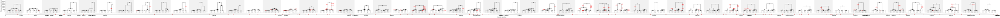

# Adding recombination

Using _tskit_ makes it easy to model recombination (i.e. sex, such that one
individual has 2 parents). In our `simForwardWF()` code, we simply
need to use a different `add_ancestry()` function.

Here's one way to add crossover recombination. We choose 2 parents, and recombine
with a certain probability, proportional to the length of simulated chromosome L. If
a crossover occurs, we pick a *recombination breakpoint* `X` along the genome, and take
the region of the chromosome from 0..X from one parent, and X..L from the other parent.

By making recombination depend on the sequence length, we can also simulate a small
region of a chromosome (i.e. the first L basepairs).

```python
# The recombination rate per base per generation (for simplicity we save
# it as a global constant, although that's generally bad programming style.
# To do this properly, we should redefine simForwardWF() to take a `rho` parameter)
RHO = None  # set this to something sensible before running

def add_ancestry(edges, child_id, parent_ids, L, rng):
    parent1, parent2 = rng.choice(parent_ids, size=2, replace=False)
    prob_recomb = np.clip(RHO * L, 0, 1)
    has_crossover = rng.binomial(n=1, p=prob_recomb)
    if has_crossover:
        X = rng.integers(1, L-1)  # breakpoint must be >0 and <L
        edges.add_row(parent=parent1, child=child_id, left=0, right=X)
        edges.add_row(parent=parent2, child=child_id, left=X, right=L)
    else:
        edges.add_row(parent=parent1, child=child_id, left=0, right=L)
```

Note that this is a highly simplified model: we don't have variable recombination rates
along the genome (i.e. a "genetic map"), we are modelling haploid hermaphrodite
individuals (rather than human-like diploids with separate sexes), we have a maximum of
one breakpoint per chromosome, and we aren't modelling gene conversion. All these things
can be done in more advanced simulators like SLiM, but the version decribed above is
a surprisingly good approximation.

Now all we need to do is run it! As before we'll output a sample of 10 nodes
from a simulated population of 1000 haploids.

```python
RHO = 1e-8   # A roughly human-like recombination rate
ts = simForwardWF(1000, 3000, chrom_length = 1e6, random_seed=321, show_progressbar=True)
current_nodes = ts.samples(time=0)
rng = np.random.default_rng(123)
ts = ts.simplify(rng.choice(current_nodes, 10))  # pick the first 10  
ts = msprime.sim_mutations(ts, rate=1.3e-8, random_seed=43) # Add mutations
```

Now let's plot it out:

```python
ts.draw_svg(y_axis=True, node_labels=ts.samples(), y_ticks=np.arange(0, 3001, 500))
```

<div className="fixed-300px-image-height">



</div>

Woah - what's going on here. Suddenly we have lots of trees!

That's because every time a recombination occurs

These are called "local trees" - the bar at the bottom of the plot is 


The shaded background is meant to show you