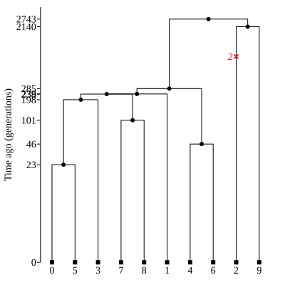
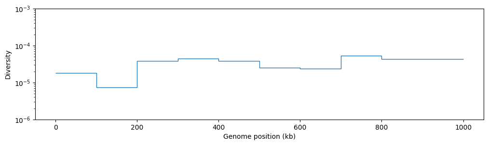

# Adding recombination

Using _tskit_ makes it easy to model recombination (i.e. sex, such that one
individual has 2 parents). In our `simForwardWF()` code, we simply
need to use a different `add_ancestry()` function.

Here's one way to add crossover recombination. We choose 2 parents, and recombine
with a certain probability, proportional to the length of simulated chromosome L. If
a crossover occurs, we pick a *recombination breakpoint* `X` along the genome, and take
the region of the chromosome from 0..X from one parent, and X..L from the other parent.

By making recombination depend on the sequence length, we can also simulate a small
region of a chromosome (i.e. the first L basepairs).

```python
# The recombination rate per base per generation (for simplicity we save
# it as a global constant, although that's generally bad programming style.
# To do this properly, we should redefine simForwardWF() to take a `rho` parameter)
RHO = None  # set this to something sensible before running

def add_ancestry(edges, child_id, parent_ids, L, rng):
    parent1, parent2 = rng.choice(parent_ids, size=2, replace=False)
    prob_recomb = np.clip(RHO * L, 0, 1)
    has_crossover = rng.binomial(n=1, p=prob_recomb)
    if has_crossover:
        X = rng.integers(1, L-1)  # breakpoint must be >0 and <L
        edges.add_row(parent=parent1, child=child_id, left=0, right=X)
        edges.add_row(parent=parent2, child=child_id, left=X, right=L)
    else:
        edges.add_row(parent=parent1, child=child_id, left=0, right=L)
```

Note that this is a highly simplified model: we don't have variable recombination rates
along the genome (i.e. a "genetic map"), we are modelling haploid hermaphrodite
individuals (rather than human-like diploids with separate sexes), we have a maximum of
one breakpoint per chromosome, and we aren't modelling gene conversion. All these things
can be done in more advanced simulators like SLiM, but the version decribed above is
a surprisingly good approximation.

Now all we need to do is run it! As before we'll output a sample of 10 genomes (nodes) of 
1Mb from a simulated population of 1000 haploids:

```python
RHO = 1e-8   # A roughly human-like recombination rate
ts = simForwardWF(1000, 3000, chrom_length = 1e6, random_seed=321, show_progressbar=True)
current_nodes = ts.samples(time=0)
rng = np.random.default_rng(123)
ts = ts.simplify(rng.choice(current_nodes, 10))  # pick the first 10  
ts = msprime.sim_mutations(ts, rate=1.3e-8, random_seed=43) # Add mutations
```

Now let's plot it out:

```python
ts.draw_svg(y_axis=True, node_labels=ts.samples(), y_ticks=np.arange(0, 3001, 500))
```

<div className="fixed-300px-image-height">


</div>

Woah - what's going on here. Suddenly we have lots of trees, each with the same set of tips!

The bar at the bottom is meant to show position along the genome.
The background shading shows the genomic region covered by each tree.
For instance, in the plot above, the first tree covers positions 0 to 16073
(on your computer, or with a different random seed, it might be different).

What's happened is that every time a recombination occurs, the chunk of genome to the
left vs the right of the breakpoint takes a different path through the ancestry. Each
recombination breakpoint in the ancestry therefore results in a new tree. The 
breakpoint positions correspond to the point along the genome that one tree switches to
the next.

We can extract the "local tree" at a particular position along the genome like this
(usually the branches near the root of the tree are much longer, so it can be helpful
to plot time on a log scale, using `time_scale="log_time"`):

```python
position=50_000  # get the tree at 50kb along the genome
tree = ts.at(position)

tree.draw_svg(size=(400, 400), node_labels=ts.samples(), y_axis=True, time_scale="log_time")
```



The _tskit_ library is specifically designed to analyse recombinant ancestry along the genome.
In particular, you might notice that one tree is very similar to the tree next to it. For 
example, nodes 7 and 8 stay grouped together as we go along the genomes. That means we
don't need to store each tree separately. Instead, the edges that connect nodes 7 and 8
to their common ancestor span from a left position of 0 to a right position of tens of thousands of basepairs.

We can extract each tree in turn using `ts.trees()`. Here's an example of counting the
number of variable sites in each tree:

```python
print({
    f"Tree {tree.index}": f"{tree.num_sites} sites" for tree in ts.trees()
})
```

`{'Tree 0': '1 sites', 'Tree 1': '1 sites', 'Tree 2': '0 sites', 'Tree 3': '0 sites', 'Tree 4': '0 sites', 'Tree 5': '1 sites', 'Tree 6': '0 sites', 'Tree 7': '2 sites', 'Tree 8': '0 sites', 'Tree 9': '1 sites', 'Tree 10': '0 sites', 'Tree 11': '0 sites', 'Tree 12': '0 sites', 'Tree 13': '0 sites', 'Tree 14': '3 sites', 'Tree 15': '5 sites', 'Tree 16': '2 sites', 'Tree 17': '8 sites', 'Tree 18': '1 sites', 'Tree 19': '0 sites', 'Tree 20': '0 sites', 'Tree 21': '2 sites', 'Tree 22': '7 sites', 'Tree 23': '2 sites', 'Tree 24': '1 sites', 'Tree 25': '2 sites', 'Tree 26': '0 sites', 'Tree 27': '0 sites', 'Tree 28': '0 sites', 'Tree 29': '2 sites', 'Tree 30': '0 sites', 'Tree 31': '9 sites', 'Tree 32': '3 sites', 'Tree 33': '6 sites', 'Tree 34': '1 sites', 'Tree 35': '0 sites', 'Tree 36': '6 sites', 'Tree 37': '1 sites', 'Tree 38': '0 sites', 'Tree 39': '8 sites', 'Tree 40': '3 sites', 'Tree 41': '0 sites', 'Tree 42': '0 sites', 'Tree 43': '0 sites', 'Tree 44': '2 sites', 'Tree 45': '0 sites', 'Tree 46': '3 sites', 'Tree 47': '2 sites', 'Tree 48': '2 sites', 'Tree 49': '2 sites', 'Tree 50': '1 sites', 'Tree 51': '2 sites', 'Tree 52': '1 sites', 'Tree 53': '0 sites'}`

Now breaking down statistics into windows along the genome make more sense,
because they don't all reflect branches on the same tree. For example, here's diversity 
along our simulated chromosome in 100kb windows

```python
fig, ax = plt.subplots(figsize=(12, 3))
L = int(ts.sequence_length)
windows = np.linspace(0, L, num=L//100_000 + 1)
ax.stairs(ts.diversity(windows=windows), windows/1_000, baseline=None)
ax.set(ylabel="Diversity", xlabel= "Genome position (kb)", yscale="log", ylim=(1e-6, 1e-3))
plt.show()
```



Not only is this a bit boring (it will become more exciting when we incorporate selection), but because this is a forward-time simulation, we aren't guaranteed that every tree has fully coalesced (i.e. some of the trees might have multiple roots).

```python
for tree in ts.trees():
    if tree.num_roots > 1:
        print(
            f"Tree {tree.index} covering {tree.interval}",
            f"has not coalesced (has {tree.num_roots} roots)"
        )
```

```
Tree 12 from Interval(left=87182.0, right=89267.0) has not coalesced (has 2 roots)
Tree 13 from Interval(left=89267.0, right=100501.0) has not coalesced (has 2 roots)
Tree 18 from Interval(left=346321.0, right=351653.0) has not coalesced (has 2 roots)
Tree 21 from Interval(left=363533.0, right=389247.0) has not coalesced (has 2 roots)
Tree 33 from Interval(left=697134.0, right=740666.0) has not coalesced (has 2 roots)
Tree 34 from Interval(left=740666.0, right=748815.0) has not coalesced (has 2 roots)
Tree 35 from Interval(left=748815.0, right=750010.0) has not coalesced (has 2 roots)
Tree 45 from Interval(left=888703.0, right=894733.0) has not coalesced (has 2 roots)
Tree 46 from Interval(left=894733.0, right=909094.0) has not coalesced (has 2 roots)
Tree 47 from Interval(left=909094.0, right=932991.0) has not coalesced (has 2 roots)
Tree 48 from Interval(left=932991.0, right=952213.0) has not coalesced (has 2 roots)
Tree 53 from Interval(left=999350.0, right=1000000.0) has not coalesced (has 2 roots)
```

So the simulated diversity in those regions is likely to be too small, and the plot
could be misleading. It looks like we should have simulated for even more generations,
but there's a clever workaround involving backward-time simulation.
