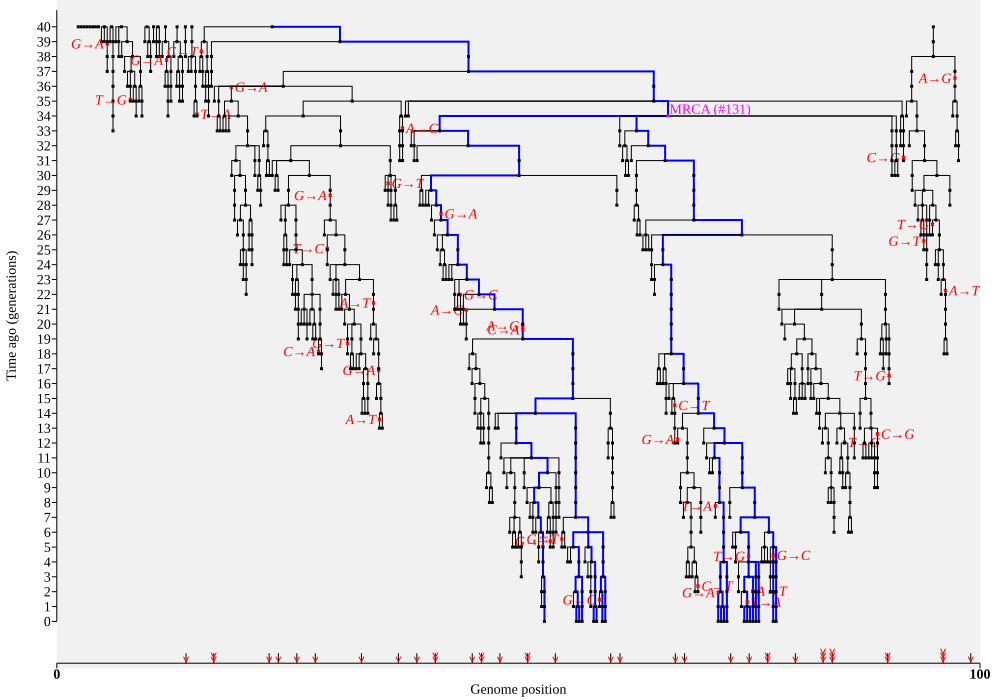
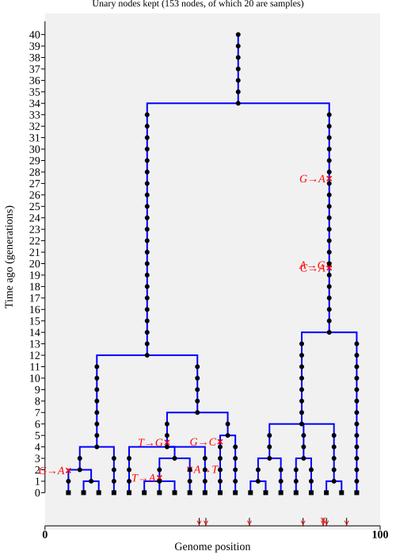
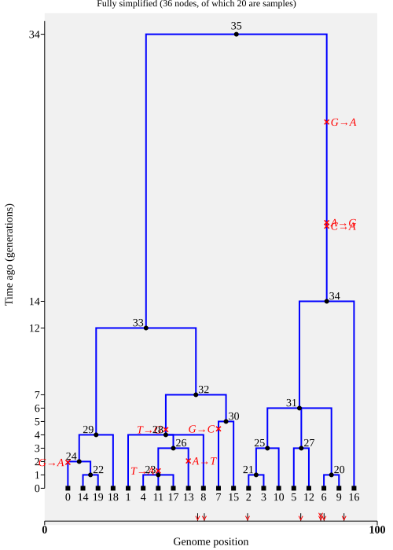
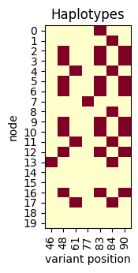

# Simplification

We'll re-simulate, saving a tree sequence with mutations in the `ts` variable.
That should save some typing!

```python
ts = msprime.sim_mutations(
    simForwardWF(20, 40, 100, random_seed=42), rate=5e-4, random_seed=42
)
```

In the ancestry plot below, it should be clear that lots of lineages never make it to
the final generation (as before, we've used blue to colour the "ancestral edges" that
lead to nodes in the current generation). All nodes, even those in the past, are
treated as samples (and plotted using a square symbol, although that might be hard to see on these plots).

```python
current_nodes = ts.samples(time=0)

# Find the MRCA of the current nodes and colour it magenta
tree = ts.first()
mrca_id = tree.mrca(*current_nodes)
style = f".node.n{mrca_id} > .sym, .node.n{mrca_id} > .lab {{fill: magenta}}"

# Next three lines just set up a style to colour edges that lead to current nodes
ancestral_nodes = {u for nd in current_nodes for u in tree.ancestors(nd)}
linestyle = "{stroke: blue; stroke-width: 2px}"
style += "".join([f".node.n{u} > .edge {linestyle}" for u in ancestral_nodes | set(current_nodes)])

mut_labels = {m.id: f"{m.inherited_state}→{m.derived_state}" for m in ts.mutations()}
ts.draw_svg(
    size=(1000, 700), style=style,
    node_labels={mrca_id: f"MRCA (#{mrca_id})"}, mutation_labels=mut_labels,
    symbol_size=3, y_axis=True,
)
```



As an aside, this code also labels and plots the most recent common ancestor (MRCA) of the
current nodes in <span style={{ fontWeight: "bold", color: "magenta" }}>magenta</span>.

**Question.** Why is the whole ancestry, including the ID of the common ancestor,
identical to that generated by the (non-_tskit_) code at the start of the practical.

It's clear that in large simulations, most of the nodes and
edges are non-ancestral "dead-ends", which never influence the current generation.
We might want to remove these, which we can do using the `simplify()` method. 

`Simplify()` takes a list of node IDs and returns a new tree sequence with only those
nodes set as samples. All the other nodes are either discarded or (if kept) are
no longer treated as sample nodes. These now non-sample nodes are plotted as
round points.

```python
fully_simplified_ts = ts.simplify(current_nodes)
mut_labels = {
    m.id: f"{m.inherited_state}→{m.derived_state}"
    for m in fully_simplified_ts.mutations()
}
fully_simplified_ts.draw_svg(
    size=(500, 700), style=f".edge {linestyle}", title=(
        f"Fully simplified ({fully_simplified_ts.num_nodes} nodes,"
        f" of which {fully_simplified_ts.num_samples} are samples)"
    ),
    mutation_labels=mut_labels, y_axis=True
)
```

By default, `simplify()` tries to remove as much as possible, but
sometimes we don't want that. Here's an example of using `keep_unary`
which we'll discuss below.

```python
simplified_ts = ts.simplify(current_nodes, keep_unary=True)
mut_labels = {
    m.id: f"{m.inherited_state}→{m.derived_state}" for m in simplified_ts.mutations()
}

simplified_ts.draw_svg(
    size=(500, 700), style=f".edge {linestyle}", title=(
        f"Unary nodes kept ({simplified_ts.num_nodes} nodes,"
        f" of which {simplified_ts.num_samples} are samples)"
    ),
    mutation_labels=mut_labels, node_labels={}, y_axis=True
)
```


<table>
<tr><td>


</td><td>


</td></tr>
</table>

You can see that `simplify()` has kept only the nodes on the blue lineage
(check that the topology is the same, e.g. the MRCA remains at 34 generations ago).

On the left, we have simplified with `keep_unary=True`, which retains all the
nodes on the blue ancestral path, including those above the MRCA; the tree
is plotted all the way back to the starting generation. On the right is the default
behaviour, which removes not only the nodes above the MRCA, but also all the
nodes which don't represent a branching point in the ancestry.

The only nodes that remain as sample nodes are at time 0:

```python
assert all(fully_simplified_ts.nodes_time[fully_simplified_ts.samples()] == 0)
```

Warning! Because we have removed nodes, the node IDs have changed! That includes the IDs of the nodes passed in as samples. By default, `simplify()` assigns new IDs starting at 0 for the new samples. They will, however, remain in the same order as we passed them in.

We can check that the fully simplified tree sequence on the right still encodes
all the variable sites in the current-day samples, even though it has 36 nodes
rather than the full 820 that we originally simulated. Note that we don't need to
specify which sample nodes to print, because the current-day nodes are the only
sample nodes left.

```python
print("== Alignments ==")
sequences = fully_simplified_ts.alignments(missing_data_character="_")
for i, seq in enumerate(sequences):
    print(f"node {i:<2} (previously ID {current_nodes[i]})", "=", seq)
```

```
== Alignments ==
node 0  (previously ID 800) = ______________________________________________A_A____________T_______________G_____AT_____C_________
node 1  (previously ID 801) = ______________________________________________A_A____________T_______________G_____GG_____C_________
node 2  (previously ID 802) = ______________________________________________A_G____________T_______________G_____AT_____A_________
node 3  (previously ID 803) = ______________________________________________A_G____________T_______________G_____AT_____A_________
node 4  (previously ID 804) = ______________________________________________A_A____________A_______________G_____GG_____C_________
node 5  (previously ID 805) = ______________________________________________A_G____________T_______________G_____AT_____A_________
node 6  (previously ID 806) = ______________________________________________A_G____________T_______________G_____AT_____A_________
node 7  (previously ID 807) = ______________________________________________A_A____________T_______________C_____GT_____C_________
node 8  (previously ID 808) = ______________________________________________A_A____________T_______________G_____GG_____C_________
node 9  (previously ID 809) = ______________________________________________A_G____________T_______________G_____AT_____A_________
node 10 (previously ID 810) = ______________________________________________A_G____________T_______________G_____AT_____A_________
node 11 (previously ID 811) = ______________________________________________A_A____________A_______________G_____GG_____C_________
node 12 (previously ID 812) = ______________________________________________A_G____________T_______________G_____AT_____A_________
node 13 (previously ID 813) = ______________________________________________T_A____________T_______________G_____GG_____C_________
node 14 (previously ID 814) = ______________________________________________A_A____________T_______________G_____GT_____C_________
node 15 (previously ID 815) = ______________________________________________A_A____________T_______________G_____GT_____C_________
node 16 (previously ID 816) = ______________________________________________A_G____________T_______________G_____AT_____A_________
node 17 (previously ID 817) = ______________________________________________A_A____________A_______________G_____GG_____C_________
node 18 (previously ID 818) = ______________________________________________A_A____________T_______________G_____GT_____C_________
node 19 (previously ID 819) = ______________________________________________A_A____________T_______________G_____GT_____C_________
```

You can see that `simplify()` has removed sites and mutations, if they are not in the
ancestry of the final samples. You can check by looking at the numbers:

```python
print(fully_simplified_ts.num_sites, fully_simplified_ts.num_mutations)
```

And here's the haplotype matrix: the blank columns, representing sites with only non-ancestral mutations, have disappeared. Again,
we don't need to specify which nodes to use, because the only sample nodea are the
ones in the current generation.

```python
plot_ts_haplotypes(fully_simplified_ts)
```



We'll finish this page by noting two things. Firstly, we we could have saved a
little bit of effort by calling `sim_mutations()` *after* simplifying, which would
avoid creating the non-ancestral mutations in the first place. Secondly, for long running
forward-time simulations, in which we are only interested in the final genomes,
it can save a great deal of computer time and memory if
the tables are simplified at periodic intervals *during* the simulation process itself.
This is what is implemented in the SLiM forward-time simulator, but
because simplification itself takes time, there's a balance for how often to perform it.