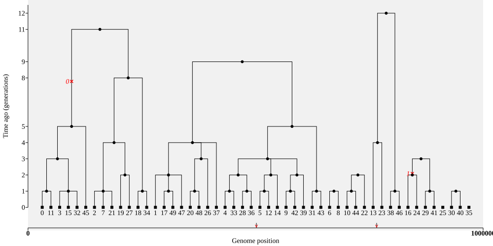
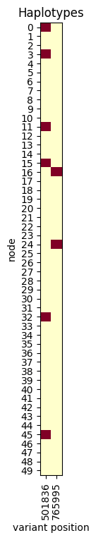
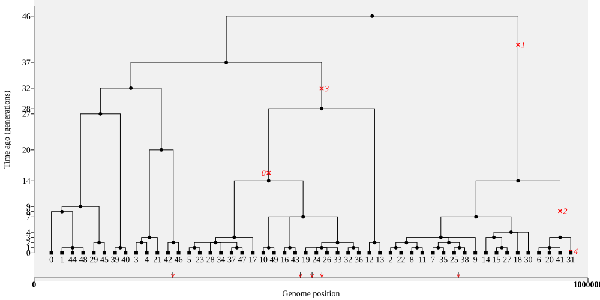
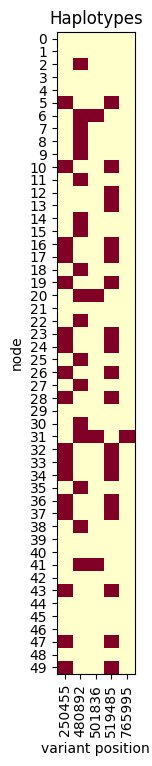

# Running time

One important question is how long a simulation should be run. This is tricky,
to answer, as it depends on the underlying model. Let's see what happens when
we run for hardly any time, simplifying so that only the nodes in the current
generation (time=0) are kept as samples. 

As normal, we save the result as `ts`, but then overwrite that with version
simplified to the current day nodes, and then overwrite *that* with a version
that has mutations added at a human-like rate ($1.3\times 10^{-8}$ mutations per
basepair per generation). We are being clever here, and saving a little bit of effort
by calling `sim_mutations()` *after* simplifying, which avoids creating any
non-ancestral mutations in the first place. 

```python
human_mu = 1.3e-8
generations = 15
ts = simForwardWF(50, G=generations, chrom_length=500_000, random_seed=42)
current_nodes = ts.samples(time=0)
ts = ts.simplify(current_nodes)  # simplify to the current generation
ts = msprime.sim_mutations(ts, rate=human_mu, random_seed=43) # Add mutations
```

Now let's plot it out! We'll only label the sample nodes.

```python
ts.draw_svg(size=(1000, 500), y_axis=True, node_labels=ts.samples())
```



This doesn't look like a single tree. It's a bit like the top of the tree has been cut off.
In _tskit_ we actually think of this a single tree, but with multiple roots. We can count the roots like this:

```python
tree = ts.at(0)
print("There are", tree.num_roots, "roots in the tree at the start of the genome")
```

**Question.** how many roots are there in this "tree"?

The associated haplotype matrix is fairly useless:

```python
plot_ts_haplotypes(ts)
```




Let's compare that to a simulation run for a much longer time:

```python
generations = 250
ts = simForwardWF(50, G=generations, chrom_length=500_000, random_seed=42)
ts = ts.simplify(ts.samples(time=0))
ts = msprime.sim_mutations(ts, rate=human_mu, random_seed=43) # Add mutations
ts.draw_svg(size=(1000, 500), y_axis=True, node_labels=ts.samples())
```



By looking at the oldest point in the tree, it looks like we didn't actually need
to run it for 250 generations!

**Question.** In this case, how many generations could we have run the simulation for?

The haplotype plot looks a bit more reasonable now:

```python
plot_ts_haplotypes(ts)
```




**Question.** What happens to the genetic diversity if we don't simulate for long enough?

In conclusion, if we are interested in differences between sampled genomes,
we need to make sure that we are adding mutations into a genetic genealogy
where all the genomes trace back to a single common ancestor (the "MRCA").
In population genetic terminology, we want the population to have *fully coalesced*.

As a rough rule, in simple models like this, the depth of ancestry in generations is
expected to be between two and four times the population size. More specifically, if we are looking at only two geneomes, the expected MRCA is 2N generations ago. As the number of samples becomes very large, the expected time to the MRCA of all of them tends to 4N generations ago.

The problem of knowing when to stop is a major issue for forward simulation. Fortunately
there's a solution that we'll come to later in the practical.

