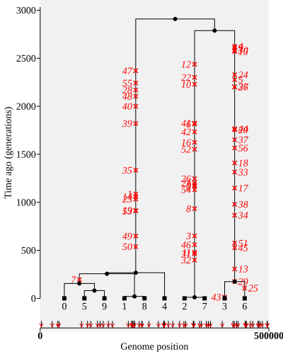
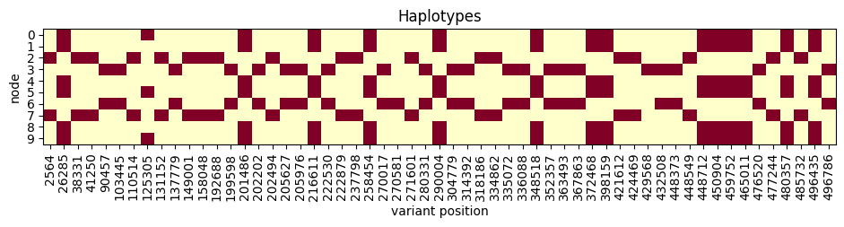
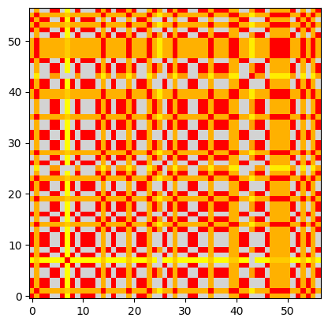
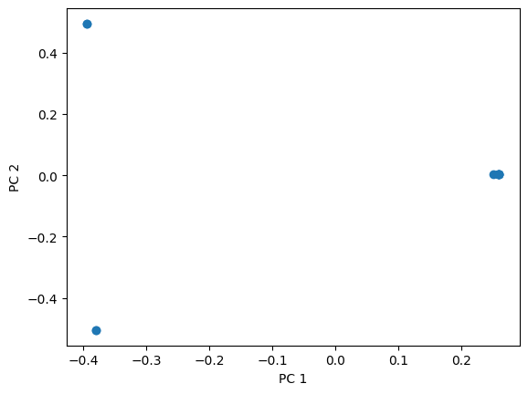

# Sampling and statistics

Usually, we aren't able to sequence everyone in a population. Instead, we have a smaller 
sample of genomes taken from a larger population. One of the main things that makes
forward-time  simulation slow is that when simulating, we need to simulate everyone in
the population (not just the genomes in the smaller sample).

Using `simplify()`, it's easy to pick a smaller sample from the simulated 
population. Below we simulate a half a megabase from a population of 1000
individuals each generation, for 3000 generations (so we save roughly 3 million
individuals!). As this might take some time, we show a progressbar. We then simplify
to a random selection of 10 individuals from the current day. 

In the code below it's assumed that you have already imported `numpy` and `msprime`.

```python
ts = simForwardWF(1000, 3000, chrom_length=500000, show_progressbar=True, random_seed=321)
current_nodes = ts.samples(time=0)
rng = np.random.default_rng(123)
ts = ts.simplify(rng.choice(current_nodes, 10))  # pick the first 10  
ts = msprime.sim_mutations(ts, rate=1.3e-8, random_seed=43) # Add mutations
```

Here is the ancestry with mutations. You can see that the ancestry stretches back
about 3000 generations, in keeping with the expected 2N to 4N...

```python
ts.draw_svg(size=(400, 500), y_axis=True, node_labels=ts.samples(), y_ticks=np.arange(0, 3001, 500))
```



... and here's the haplotype matrix generated by those mutations 

```python
plot_ts_haplotypes(ts)
```




As well as providing a container to store ancestry and mutations, _tskit_ can 
calculate population genetic statistics on the tree sequence. This is often
*much* faster than conventional methods used to compare genomes, because it
can use the tree structure.

For example, here is an LD matrix:

```
LD = ts.ld_matrix()

fig, ax = plt.subplots()
ld_colours = plt.colormaps["autumn_r"].with_extremes(under="lightgrey")
ax.imshow(LD, cmap=ld_colours, vmin=0.1, vmax=1, origin="lower")
```



It's also trivial to calculate the pairwise difference (π) between the genomes

```python
pi = ts.diversity()
print("π = {pi}")
```

(we'll see later how this can also be done in windows along the genome)

```
π = 4.511111111111111e-05
```

For reference, in humans about 1 base in 1000 differs between genomes,
i.e. $\pi \approx 1\times 10^{-3}$. Our value is about 20 times smaller,
which implies that to simulate humans, we want an ancestry that stretches back
20 times longer (giving 20 times longer for mutations to accumulate).

**Question.** Given that estimate, for a semi-realistic simulation of modern
humans, what should the population size `N` be set to in our `simForwardWF()`
function? How about the number of generations?

There are plenty more statistics built-in to tskit. For instance, you can
run a principal components analysis (PCA) on your tree sequence, to look
for population clustering, and you can slice that PCA both along the genome
and through time.

```python
pca = ts.pca(num_components=2)

fig, ax = plt.subplots()
ax.scatter(pca.factors[:,0],pca.factors[:,1])
ax.set(xlabel="PC 1", ylabel="PC 2")
plt.show()
```



(for this simulation, the PCA results are very unimpressive, because we don't
have any recombination; we'll add that to the model on the next page)

The available _tskit_ statistics are described in the
[statistics section](https://tskit.dev/tskit/docs/stable/stats.html)
of the [official documentation](https://tskit.dev/tskit/docs/). One important
thing to note is that for every statistic you calculate on the haplotypes,
there is an equivalent statistic base on the tree branch lengths. That's because
we assume that mutations accumulate randomly over time, so that the difference
between any two sequences in terms of number of variable sites is a measure of
the branch length between them.

As a result, if you are simulating genetic data,
you may not need to simulation mutations at all! A fuller explanation is provided
in [a tutorial](https://tskit.dev/tutorials/no_mutations.html) on the extensive
[_tskit_ tutorials](https://tskit.dev/tutorials/) site.