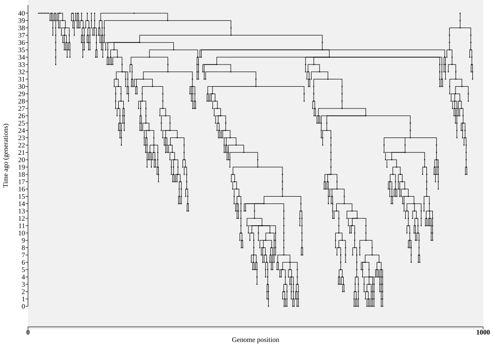

# Saving ancestry in tskit

If we want to scale up our simulations to store and analyse millions of
individual genomes we need something more sophisticated than allocating
all the nodes and edges at the start. Instead, we'll use the
[tskit](https://tskit.dev/tskit/docs) library.
You can think of this as a slightly more sophisticated way to
store *nodes* and *edges* (and haplotypes too, which we'll come to later).


Although _tskit_ can be used from R, it's much more natural
to use its [Python interface](https://tskit.dev/tskit/docs/stable/python-api.html),
so we'll switch to only show Python code. Fortunately, _tskit_ actually makes the code
simpler: we just store the nodes as rows in a "nodes table", and the edges as rows in
an "edges table". 

A few more things: saving the edges is spun off
into its own function, `add_ancestry()`,
and the empty tables are created by calling `tables = tskit.TableCollection(L)`.
Here, L is the length of the genome we are simulating, which for simplicity we'll
assume to be a single chromomsome.

```python
import numpy as np
import tskit

def add_ancestry(edges, child_id, parent_ids, L, rng):
    # link children to one random parent: we can modify this later  
    parent_id = rng.choice(parent_ids) # select a single parent
    edges.add_row(parent=parent_id, child=child_id, left=0, right=L)

def WFsimulation(N, G, chrom_length, random_seed=None):
    rng = np.random.default_rng(random_seed)
    tables = tskit.TableCollection(chrom_length)
    tables.time_units="generations"  # optional
    flags = tskit.NODE_IS_SAMPLE
    parent_ids = [tables.nodes.add_row(flags, time=G) for _ in range(N)]

    for g in reversed(range(G)):
        child_ids = [tables.nodes.add_row(flags, time=g) for _ in range(N)]
        for child in child_ids:
            add_ancestry(tables.edges, child, parent_ids, chrom_length, rng)
        parent_ids = child_ids

    tables.sort()
    return tables.tree_sequence()
```

As well as accessing the nodes using `tables.nodes` and the edges using `tables.edges`,
you'll see a few other novelties:
* The `add_row()` method is used to add nodes to the node table one-by-one. We specify a `time` and another variable called `flags` (which we'll return to shortly).
* When `nodes.add_row()` is called, it returns the ID of
the added node: the code uses a Python
[list comprehension](https://docs.python.org/3/tutorial/datastructures.html#list-comprehensions) to create a list of all the added node IDs. 
* Each edge is added with not just a `parent` and `child`, but also a `left` and `right`.
This defines the *span* of genome that is inherited by each edge
(at the moment this span is the whole genome)
* The more eagle eyed
among you might notice that we have reversed the meaning of `time`: the initial
nodes are at time G, and the most recent at time 0. One easy way to think of this is that
time measures "generations ago". _Tskit_ requires 

Finally (and perhaps most importantly), instead of return the tables directly,
we `sort()` them (which puts the edges in a standard order), and return the
tables transformed into a **succinct tree sequence** (or "tree sequence" for short).
You can think of a tree sequence as a set of sanity-checked tables
(for instance, we check that parent nodes are always older than their children). 

Ensuring that the tables are in "tree sequence" format means we know that the
ancestry makes sense. That enables all sorts of extra functionality, e.g. plotting
the ancestry:

```python
ts = WFsimulation(20, 40, 100, random_seed=42)
ts.draw_svg(size=(1000, 700), node_labels={}, symbol_size=2, y_axis=True)
```

Here we've saved the output under the name `ts`, which stands for "tree sequence".
A tree sequence has *lots* of functions (or "methods") asociated with it, such as
`draw_svg()` which when run in a Jupyter notebook, plots the ancestry on screen,
in Scalable Vector Graphics ([SVG](https://en.wikipedia.org/wiki/SVG)) format.



