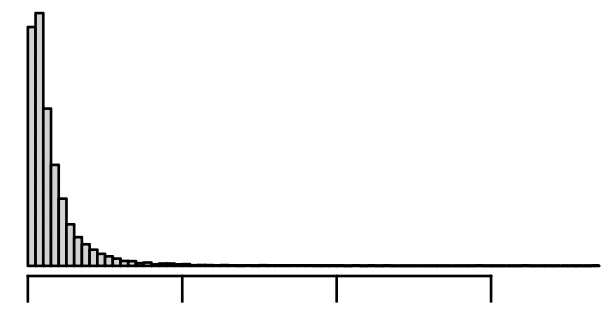
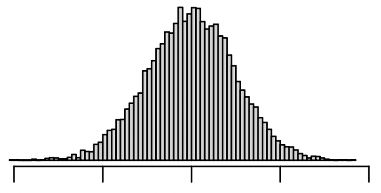
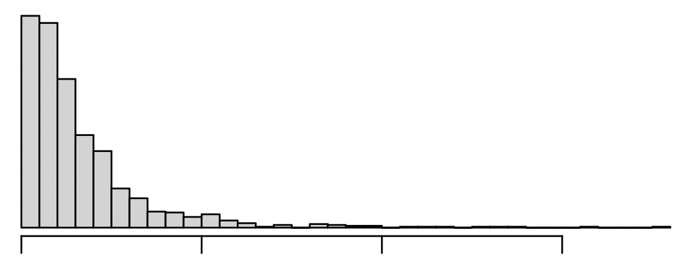
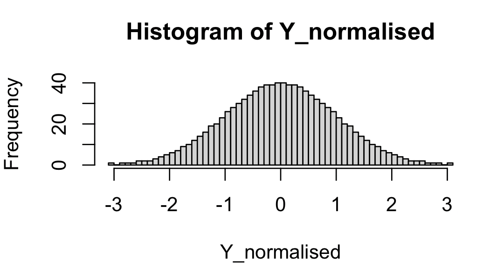

# Guidance on transforming Y

The [forms of regression](../forms_of_regression.md) page suggested how you can pick a regression model based on the
form of $Y$ - for example, whether it's continuous, binary, a count, or something else.

However you could of course transform $Y$ in different ways - which should you pick?

The first piece of guidance about $Y$ is **not to transform it** if you can - that is, try to analyse it on its
'natural' scale (i.e. whatever its natural unit of measurement is) wherever possible. Because then you can interpret the
regression results on this scale too, making interpretation easy.  This rule dictates that - if you can - it's a good
idea to try and find a regression model that models $Y$ directly rather than transforming it.

However, you're sometimes faced with data that is highly skewed - it could for example look like this:



That won't fit a normal distribution very well - but a **log transformation** can work wonders:



You'd probably be happy to use a normal distribution (i.e. a linear model) to fit a model of this transformed $Y$.
Interpretation won't be too bad - you're just estimating effects on the $\log(Y)$ instead of $Y$.

Moreover, some variables - such as the expression level of a gene, estimated as for example a 'TPM' value - often do
tend to look skewed like this.  Moreover, expression levels also tend to vary widely so you might well think that
'multiplicative' scales like this log one actually are the natural scale to analyse on.  Hence, a regression of $Y =
\log \text{TPM}$ might be just as sensible as $Y = \text{TPM}$ itself.   (You also see $Y = \log (\text{TPM} + 1)$
which helps avoid problems when $\text{TPM}=0$.)

:::tip Note on TPM

On the other hand - since `TPM` is a fraction (it's an estimate of the fraction of all mRNA transcripts that came from this particular gene) - maybe you should use [beta regression](../forms_of_regression.md) to analyse it instead?  That's not such a bad idea.

:::

## The nuclear option 

The **nuclear option** for all variables is to **rank-transform** (or 'quantile normalise') them so that they definitely definitely fit the distribution.  Like this:
```r
Y = exp( rnorm( 1000 ))
hist( Y, 50 )
```
Uh-oh, not very normal!



Let's quantile normalise it:

```r
# Quantile normalise
N = length(Y)
Y_ranks = rank( Y )
Y_normalised = qnorm( Y_ranks / (N+1) )
hist( Y_normalised, 50  )
```



This can be a good way to sanity check results of a linear regression, but I **strongly advise against it** for your 'main' analyses.  This is because

1. You can't interpret the results very well any more - what does $\beta$ mean if $Y$ has this transformed scale?

2. You might as well use [rank regression methods](https://pmc.ncbi.nlm.nih.gov/articles/PMC4248265/) in this case.

