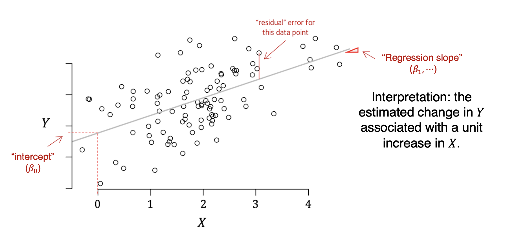

# Interpreting regression output

Whichever [flavour](./forms_of_regression.md) of regression you run, you'll get output looking like a big table of
numbers, something like this:

```r
# A tibble: 3 × 5
  term             estimate std.error statistic  p.value
  <chr>               <dbl>     <dbl>     <dbl>    <dbl>
1 (Intercept)       -0.0147    0.0224    -0.658 5.12e- 1
2 my_X_variable      0.239     0.0299     7.99  2.82e-12
3 another_variable   0.0342    0.0201     1.70  9.22e- 2
```

How should we interpret that?

In one sense, interpreting these results is the **same for all regression models**.  For example, here we see that:

* The estimated association between $X$ and the $Y$ variable is $0.239$;
* The estimated *standard error*, which reflects how uncertain the model is about the estimate, is $0.0299$;
* And, as a result, the P-value (which reflects "how likely such a big estimate was if there were no true association" )
  is pretty small in this example - $\text{p-value} = 2.8\times 10^{-12}$.

(In other words, such a strong association seems vanishingly unlikely 'by chance'.)

However, the differences between regression models come when you want to interpret the estimates in terms of the
original variable $Y$.  This is because of the different link functions used for the different types of regression,
which means that the linear predictor (and so the parameters) are on different scales.

Here is a quick rundown and then a description.

|                    | Linear             | Logistic                | Poisson        |
| ------------------ | ---------          | ---------               | -------------- |
| $Y$ represents:    | A continuous value | A binary $0/1$ variable | A count, e.g. of events |
| Intercept<br/><small>or "baseline"</small><br/>parameter          | Estimated **mean of $Y$**<br/><small>when all other predictors are $0$</small> | Estimated **log-odds of $Y$**<br/><small>when all other predictors are $0$</small> | Estimated **log of rate of $Y$**<br/><small>when all other predictors are $0$</small> | 
| Other parameters   | Estimated **change in $Y$**<br/><small>for unit increase in predictor</small> | Estimated **change in log-odds of $Y$**<br/><small>for unit increase in predictor</small> | Estimated **change in $\log(\text{rate})$ of $Y$**<br/><small>for unit increase in predictor</small> |

I hope you see the pattern here - it's similar for each model, and interpretable as long you know the
appropriate scale.

## Interpretaiton in specific models

### Linear regression

For linear regression, the "link" function is just the identity function, $y=x$, and so the estimates are on the same
scale as $Y$.  The parameter interpretation is:

**Intercept**: "the estimated mean value of $Y$, when all the other predictors are $0$.".

**Other parameters**: "the estimated change in $Y$ associated with a unit increase in the predictor".

But this is probably easier to remember using a picture:



The picture shows what is going on - the linear regression model tries to find a line of 'best fit' between the
predictor variables and $Y$, and the parameters are the parameters of this line.  (If there are more than one $X$
variable, it becomes multi-dimensional, so it's a 'plane' rather than a line.)

### Logistic regression

For logistic regression, there's a nontrivial link function to worry about - the logistic function:
$$
\text{logistic}(x) = \frac{e^x}{1+e^x}
$$

The logistic function maps the linear predictor to a probability, which is then used in the binomial distribution.

To understand this, let's try going the other way, from a probability $p$ to the predictor scale.  It turns out this
mapping works like this.  First, convert the probability to an odds:
$$
\text{odds}(p) = \frac{p}{1-p} \qquad\text{(this lies in the range $[0, \infty]$)}
$$
and then take a logarithm to get it in the range $(-\infty, \infty)$:
$$
\text{logodds}(p) = \log\left( \frac{p}{1-p}\right)
$$

In a sense, log-odds is just a useful way of representing a probability - as something that can take any real number
value - and to get a probability back you use the logistic function.

What this means for the regression result is:

**Intercept**. The intercept is the modelled log-odds of $Y$, when all the other predictors are $0$; and

The other parameters are interpreted as "the change in log-odds, or **$\log\left(\text{odds ratio}\right)$**, associated with a unit increase in the predictor."

Easy?

### Poisson regression


Here is a quick guide to interpreting the output:

| Column of output | Interpretation |
| ---------------- | -------------- |
| Overall output   | Represents a *normal distribution approximation* to the full likelihood |
| `estimate`       | The *maximum likelihood* estimate of the parameter<br /><small>I.e. what's the model's best estimate of the parameter, given the data?</small> |
| `std.error`      | The estimated *standard error* of the parameter estimate.<br/> <small>I.e. how much uncertainty do we have about the parameter, given the data?</small> |
| `p.value`        | A p-value<br/><small>I.e. how unlikely did the model think it was to see such a large effect, if the effect was actually zero?</small><br/> |

You should realise that the model output reflects a **normal approximation to the full inference**, which is why it's
happy to output just parameter estimates and standard errors.  Here are some things to look for when interpreting the output:

* What do the estimates say about the 'best estimated' relationship between $X$ and $Y$?  (Remember the estimates are in the scale of the [linear predictor](./forms_of_regression.md)).

* But *also* look at the standard error.  Do we have any confidence that the estimate of the parameter is accurate?

A useful rule-of-thumb guide is to think here of a **95% interval** for the estimate - computed as $\text{estimate} \pm
1.96\times \text{standard error}$.  You could reasonably think of the true value of the parameter as probably
being somewhere within this range.

The p-value also reflects this - very roughly, it reflects "how many standard errors from zero" is the estimate?

* *Also* look at the p-value.  If $p < 0.05$, this would (approximately) correspond to the estimate being about 1.96 standard
  errors from zero.

:::tip Note

More generally the correspondence is given by `pnorm()` - at least in large samples, the P-value will approximately be:

```r
# compute the p-value using pnorm
pnorm( -abs( <estimate> ), sd = <standard error> ) * 2
```

This is a **two-tailed pvalue** and reflects the idea that the model fit is a normal approximation to the likelihood.

(Note the `-abs()` part is just to make sure we are computing the area under the left tail of the normal distribution.)

:::

## Complete example:

For example here was our [earlier logistic regression](./logistic_regression.md):

```
simulated_data2 = tibble::tibble(
	# Simulate a genotype taking values 0, 1, 2:
	cigarettes_per_day            = rbinom( 100, size = 10, prob = 0.1 ),
	lung_cancer                   = rbinom( 100, size = 1, prob = logistic( -2 + cigarettes_per_day * 2 ))
)

fit = glm( lung_cancer ~ cigarettes_per_day, data = simulated_data2, family = "binomial" )

broom::tidy(fit)
```

Producing:
```
# A tibble: 2 × 5
  term               estimate std.error statistic     p.value
  <chr>                 <dbl>     <dbl>     <dbl>       <dbl>
1 (Intercept)           -2.23     0.516     -4.33 0.0000148  
2 cigarettes_per_day     2.40     0.466      5.15 0.000000255
```

Here, the estimated effect was that the log-odds of cancer increased by 2.4 for each additional cigarette smoked per day.
The standard error is 0.466 so this is 
$$
\frac{2.4}{0.466} = 5.15
$$

standard errors away from zero.  That's pretty unlikely if the true effect was zero, and the p-value confirms this:
```r
# Compute the p-value using pnorm
pnorm( -2.4, sd = 0.466 ) * 2
```
giving $2.6 \times 10^{-7}$.

```r
broom::tidy( fit ) %>% mutate(
	standard_errors_from_zero = estimate / std.error,
	two_tailed_p_value        = pnorm( -abs( estimate ), sd = std.error ) * 2
)
```

We could also get a 95% confidence/credible interval - the simplest way is to go our $1.96$ standard errors from the estimate:

```r
broom::tidy( fit ) %>% mutate(
	standard_errors_from_zero = estimate / std.error,
	two_tailed_p_value        = pnorm( -abs( estimate ), sd = std.error ) * 2,
	lower                     = estimate - 1.96 * std.error,
	upper                     = estimate - 1.96 * std.error
)
```

Lastly you may well want to get those estimates / intervals on the **odds scale**:
```r
broom::tidy( fit ) %>% mutate(
	standard_errors_from_zero = estimate / std.error,
	two_tailed_p_value        = pnorm( -abs( estimate ), sd = std.error ) * 2,
	lower                     = estimate - 1.96 * std.error,
	upper                     = estimate + 1.96 * std.error,
	estimated_OR              = exp( estimate ),
	OR_lower                  = exp( lower ),
	OR_upper                  = exp( upper )
)
```
