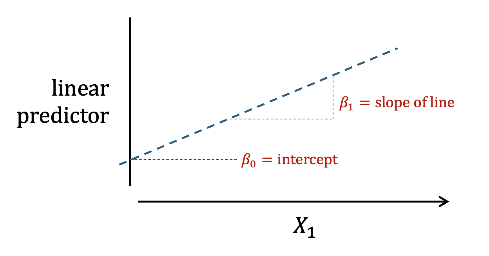
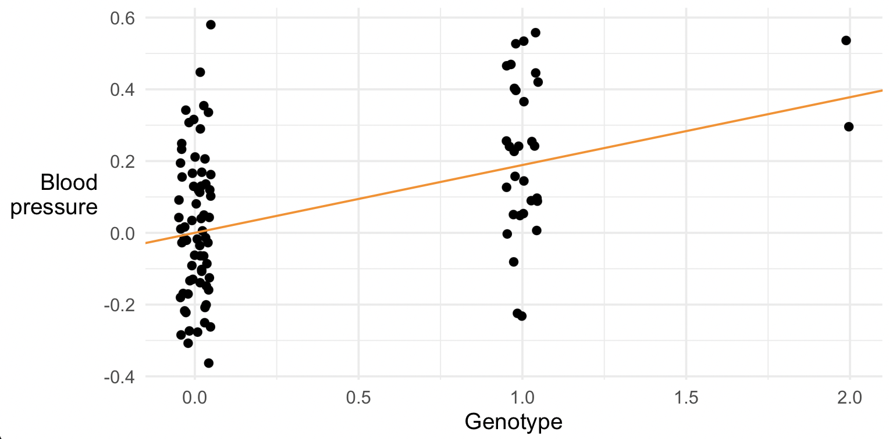

# Regression 101

If you followed [Basics to Bayes](../introduction/README.md) you'll have got used to modelling data variables using
probability distributions.  In **regression**, you do this by creating a model of one variable - call it $Y$ - it terms
of another variable $X$.  (Or maybe it's several other variables $X_1, X_2, \cdots$.)

The basic idea is:

* Take the various $X$ variables and combine them into a single predictor variable, based on some *parameters*.
* Model $Y$ using an appropriate distribution, but parameterised as a function of the predictor.

The most common way of doing this is to combine the $X$ variables linearly, like this:
$$
\text{"linear" predictor} = \beta_0 + \beta_1 X_1 + \beta_2 X_2 + \cdots
$$

and then to arrange things so that the mean of the $Y$ distribution is a function of the linear predictor.  

It's usual to add a $\beta_0$ term to the predictor, as we did above.  So, if there's only one $X$ variable, it is of course the equation of a line:



(But if there are more than one $X$ variable, it's the equation of a plane instead.)

In short regression will 'fit' the line to the data - that is it will find parameters that provide the best explanation, or model, of the $Y$ data.

A bit of code speaks a thousand words so for example - here's a **linear regression** fit using some simulated data:
```r
simulated_data = tibble::tibble(
	# Simulate a genotype taking values 0, 1, 2:
	genotype               = rbinom( 100, size = 2, prob = 0.2 ),
	# Simulate a normally distributed variable:
	another_variable       = rnorm( 100, sd = 1 ),
	# Simulate an 'outcome' variable that depends on those variables:
	blood_pressure         = (
		genotype * 0.2                   # effect of the genotype
		+ another_variable * 0.05        # effect of the other variable
		+ rnorm( 100, sd = 0.2 )         # some random 'noise'
	)
)

# this runs the regression and prints the results nicely:
broom::tidy(
	# here is the actual regression:
	lm(
		# the model 'formula':
		blood_pressure ~ genotype + another_variable,
		# the model data:
		data = simulated_data
	)
)
```

This will produce something like:
```
# A tibble: 3 × 5
  term             estimate std.error statistic  p.value
  <chr>               <dbl>     <dbl>     <dbl>    <dbl>
1 (Intercept)       -0.0147    0.0224    -0.658 5.12e- 1    # This is β_0!
2 genotype           0.239     0.0299     7.99  2.82e-12    # ... β_1!
3 another_variable   0.0342    0.0201     1.70  9.22e- 2    # ... β_2!
```

Look at the results for a minute - lot of numbers!  You ought to be able to see, though, that in this fit the genotype
is estimated to have a *positive* association with blood pressure, that is much bigger than its standard error. And the other variable has a smaller estimated effect. 

This regression has also done a pretty good job of getting these parameters!  These estimates aren't a million miles
from the true effects ($0.2$ and $0.05$) that were simulated.  

:::tip Illustration

This toy analysis therefore illustrates a key reason for wanting to do regression.  It lets you flexibly model one variable $Y$ in terms of another variable $X$, while
controlling for, or including other variables of interest.

:::

In this **linear regression** example - the result is exactly as it was described above: it's a straight line (or plane) that 'best fits' the data:



In the linear regression model the [normal distribution](../introduction/distributions/normal.md) is used to model the
residuals - that is, the differences between the data points and the line.  Because of this it turns out this is the
line which **minimises the sum of squared distances** of the points to the line.  Or alternatively, it's the line which **maximises the likelihood** of the $Y$ values given the $X$ values, assuming the residuals are normally distributed.

Not all regression models are quite as simple as this to interpret, but they all have this idea of fitting the parameters to find the best-fitting predictor going on under the hood.

To learn more about regression, find out about [different forms of regression](./forms_of_regression.md).
