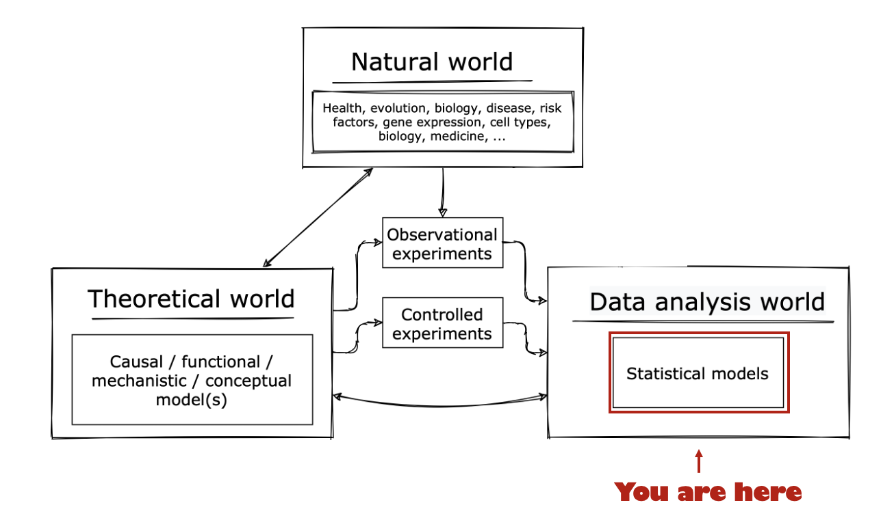

# Intermission

Congratulations!  If you got this far you've

- explored the idea of probability distributions and [calculated an example](./distributions.md)
- created some R functions to [sample from, and evaluate your example](./dice_example1/README.md)
- conducted a real Bayesian statistical inference involving [dice and blu-tack](./dice_example2/)

This last example was also interesting because - although we are working on the right of this picture:

...actually all the models we tested were derived from our scientific understanding on the left.
To illustrate this, consider:

:::tip Question

How do you know that (for example) I didn't just make a mistake in writing down the numbers?

Or that I hadn't just edited the data to make it work?

Or maybe my colleague (who did some of the experiments) played a practical joke?

:::