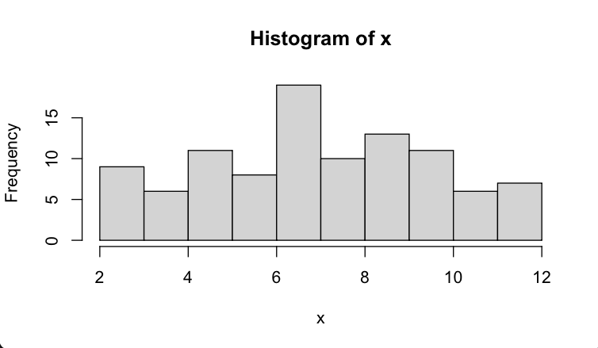

# Simulating two dice rolls

## Basic dice simulation 

Let's write code to simulate rolling two dice - and plot it.

The `sample()` function is a very helpful R function that (as its name suggests) lets you sample from a set of things.

For example to 'roll' one dice in R, we could just sample possible results. E.g. let's roll a dice 100 times:

```r
sample( 1:6, size = 100, replace = TRUE )
```

To sample two dice... we could just do it twice:
```r
sample( 1:6, size = 100, replace = TRUE ) + sample( 1:6, size = 100, replace = TRUE )
```

:::warning Note

You need `replace = TRUE` here because you can't sample 100 things from only 6, unless you replace each one you pick!

:::

Let's make that a reuseable function:

```r
simulate_two_dice <- function( number_of_rolls ) {
	die1 = sample( 1:6, size = number_of_rolls, replace = T )
	die2 = sample( 1:6, size = number_of_rolls, replace = T )
	return(
		tibble::tibble(
			roll = 1:number_of_rolls,
			sum_of_dice = die1 + die2
		)
	)
}
```

Try running it a couple of times - looks good?

## Visualising it

To convince ourselves this is working, let's try plotting a **histogram**.

:::tip Note

A **histogram** is a simple, data-based estimate of a distribution.  It separates values into a set of *bins*
and then plots the counts, or frequencies in each bin.

A basic function to do this in R is `hist()`.

:::


```r
simulation = simulate_two_dice( 100 )
hist( simulation$sum_of_dice )
```



It can look slightly better if we specify 'breaks' to tell the histogram function how to bin values:
```r
breaks = (2:13)-0.5 # 'breaks' between histogram values
hist( simulation$sum_of_dice, breaks = breaks )
```

We could also compute the **sample mean** and **sample variance**:
```r
mean( simulation$sum_of_dice )
var( simulation$sum_of_dice )
```

Hmm.  Is the simulated distribution similar to the theoretical distribution we worked out in class?  Not particularly.

## Try more rolls!

What happens if we increase the number of rolls?

```r
simulation = simulate_two_dice( 10000 )
hist( simulation$sum_of_dice, breaks = my_breaks )
```

Hmm.

:::tip Note

How far off are the mean, or variance in the simulation?  Use `mean()` and `var()` to find out - you can compare to
[your earlier computation](../summarising_distributions.md).

Of course that's just one simulation.  Here's a bit of code that will instead run 10,000 simulations,
each with 100 rolls of two dice, 10,000 times over, to find out how much they vary:
```r
variation = (
	tibble::tibble( attempt = 1:10000 )
	%>% group_by( attempt )
	# reframe() is like summarise(), but you can return multiple values:
	%>% reframe(
		simulate_two_dice( number_of_rolls = 100 )
	)
	%>% group_by( attempt )
	%>% summarise(
		mean     = mean( sum_of_dice ),
		variance = var( sum_of_dice )
	)
)
```

```r
hist( variation$mean, xlim = c( 2, 12 ) )
```

```r
hist( variation$variance, xlim = c( 2, 12 ) )
```

Hmm.  You'll probably find this **sample mean** varies from about $6$ to $8$, and the **sample variance** from about $3$ to $9$.
The true distribution mean and variance were **7** and **5.83**, so they are in the right ballpark.

(What about if you increase the number of rolls?)

:::

## Digression: plotting using ggplot

As an aside - maybe you prefer ggplot?

```r
library( ggplot2 )
(

)
simulation = 
print( simulation )

p = (
	ggplot( data = simulate_two_dice( 10000 ))
	+ geom_histogram(
		aes( x = sum_of_dice ),
		breaks = (2:13)-0.5
	)
	+ theme_minimal()
)

print(p)
```

### A better ggplot

Hmm.  In a complete digression, to make it better I'll also set a nicer theme:
```r
mytheme = function( fontsize = 16 ) {
	(
		theme_minimal( base_size = fontsize, base_family = "gill sans" )
		+ theme(
			axis.title.y = element_text( angle = 0, hjust = 1, vjust = 0.5 )
		)
	)
}
```

And also add an X scale and some axis labels:
```r
p = (
	ggplot( data = simulate_two_dice( 10000 ))
	+ geom_histogram( aes( x = sum_of_dice ), breaks = (2:13)-0.5, colour = 'black' )
	+ scale_x_continuous( breaks = 2:12 )
	+ xlab( "Sum of dice" )
	+ ylab( "Count" )
	+ mytheme()
)
print(p)
```
