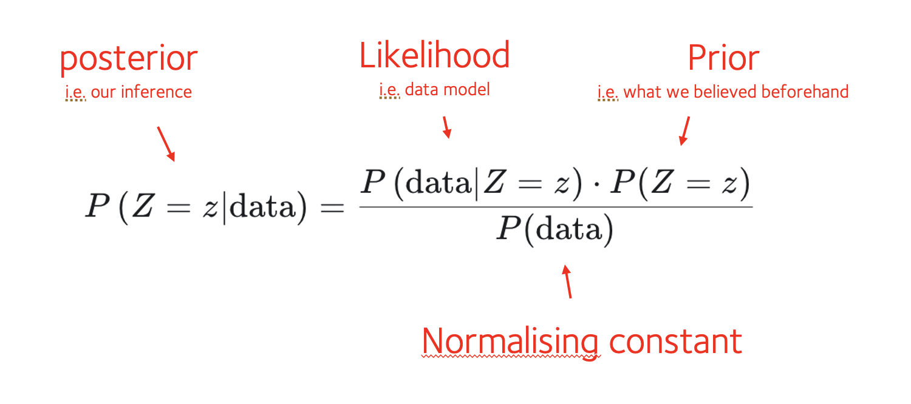
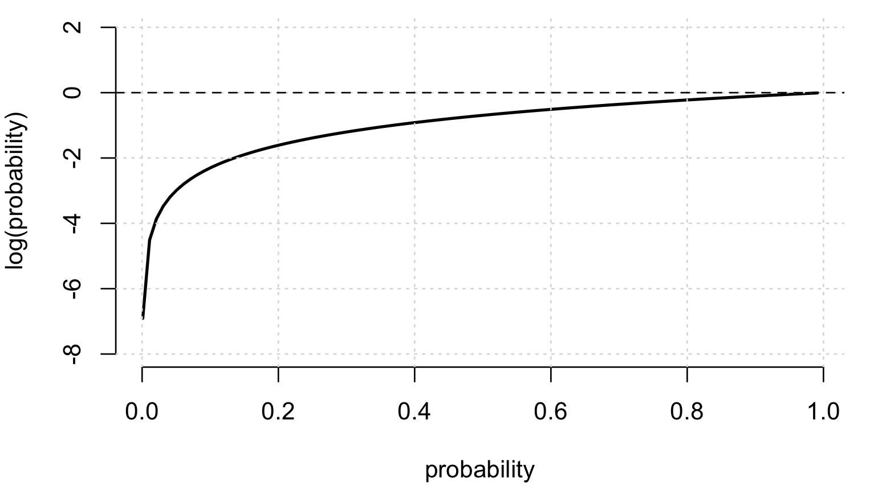

# Computing the (log)likelihood

Inference should be easy, shouldn't it?  We just need Bayes' theorem:



To use it we'll work like this:

1. We'll set $Z$ to mean 'our model fo the dice', with different models representing the blu-tack possibilities.

2. We'll then compute a *likelihood* of each model.

3. We'll multiply by a *prior* probability..

4. and we'll renormalise to compute the **posterior probability for each model**.  

Whichever is most likely, must be our model.

Sounds easy!  Let's try now.

## The likelihood

First let's create a likelihood function - the **probability of the data given the model**, for any given model of the dice.

Luckily, you've pretty much got this already!  Remember that function [`two_dice_likelihood()`](../dice_example1/03_unfair_distribution.md) that we happened to call 'likelihood' earlier?  Turns out this does the job for us.

For example, for a fair die model:
```r
fair_die_model = rep( 1/6, 6 )
two_dice_likelihood( data$sum_of_dice, fair_die_model )
```

Yay!  Lots of probabilities!

## Independence day

Hmm.  Ok, that produces one probability value *per roll*.  What we really want is the overall probability of the data.

How should we combine probabilities?  Well, we have an important thing to work with: the seperate dice rolls are
**independent of each other** and therefore we ought to be able to **multiply probabilities**

$$
P(\text{roll 1}, \text{roll 2}, \text{roll 3}, ... ) = P(\text{roll 1}) \times P(\text{roll 2}) \times \cdots
$$

:::caution Note

Well, this isn't quite right.  For two reasons.

1. Firstly, the dice have blu-tack on.  So they're going to avoid similar numbers each time.
2. Secondly, the dice have blu-tack on!  Which could for example be getting dented on each roll, affecting the next roll.

Let's imagine the second effect is relatively minor (I can confirm the blu-tack stayed on, at least), what we can
probably safely assume is that they are **approximately independent given the side the blu-tack is on**.

If $B$ denotes 'which side the blu-tack is on', we could write this as:

$$
P( \text{roll 1}, \text{roll 2}, \cdots | B ) \approx P( \text{roll 1}  | B ) \times P( \text{roll 2} | B ) \times \cdots
$$

Luckily $B$ is exactly the model we are calculating the likelihood for!  So the upshot is yes we can just **multiply the
probabilities** across the different dice rolls.

(If you are not used to this way of thinking you need the [probability cheatsheet](../../probability_cheatsheet.md).)
:::

:::warning Notation note
In probability symbols, we use a vertical bar $|$ to mean 'given', so for example:

* $P(\text{it's cloudy} | \text{it's raining})$
* $P(\text{statistics is fun} | \text{it's bayesian})$

and so on.

To make things sound more exciting, statisticians also sometimes say "conditional on" instead of "given".

:::

## The overall likelihood

So let's try:
```r
# Function to compute overall likelihood
total_likelihood = function( sum_of_dice, die_model = rep( 1/6, 6 ) ) {
	prod(
		two_dice_likelihood( sum_of_dice, probabilities )$probability
	)
}
```

Before running this function on the data - stop for a minute and think what you think the likelihood will be.  It's the likelihood of this particular set of dice results, over a run of 30 dice rolls.  Will the probability be close to 1?  Close to 0?
Somewhere in between?

```r
total_likelihood( data$sum_of_dice, fair_die_model )
```

**Uh-oh.**  If you look at the value of this you'll see it's *tiny*.  (How tiny?)

This is in fact typical of real data models, and is expected. After all, for our set of 30 dice rolls, there are 

$$11^{30} = 1.7\times 10^{31}$$

possible outcomes.  And we are looking at the probability of **just one of them**.  No wonder the
number is small.

## Log space warning

:::warning Warning

What's happening is we are multiplying lots of small numbers here (lots of probabilities < 1).

It's working but we're at risk of the computer running out of precision and **underflowing**.  Indeed if the number of data
points was larger - say 100, or 1,000, our function would probably fail. (The probabilities would get so small the computer couldn't keep track.)

:::

For this reason it is generally better to compute a **log-likelihood**.


## The overall log-likelihood

To better deal with tiny numbers we are going to switch to working in 'log space' - that is, working with log
probabilities.  

It works like this.  Here is a graph of $\log(x)$ over the range of probabilities $[0,1]$:



The log transformation has three key properties:

1. probabilities get converted to negative numbers between $-\infty$ and $0$.
2. Tiny numbers (like $10^{-30}$) get converted into large, but not *that* large negative numbers (like $-70$).  They become more numerically manageable numerically.  
3. And multiplication of probabilities corresponds to addition of log-probabilities.

For these reason it is **common to represent probabilities in log space** and then use addition of log probabilities instead of multiplication of probabilities.  So let's do that instead:
```r
total_loglikelihood = function( sum_of_dice, die_model = rep( 1/6, 6 ) ) {
	sum(
		log(
			two_dice_likelihood( sum_of_dice, die_model )$probability
		)
	)
}
```

:::tip Question

For example, what's the loglikelihood under a model where $4$ is omitted?  (E.g. `c( 0.2, 0.2, 0.2, 0, 0.2, 0.2 )`)

What about 5?

Why is this happening?

:::