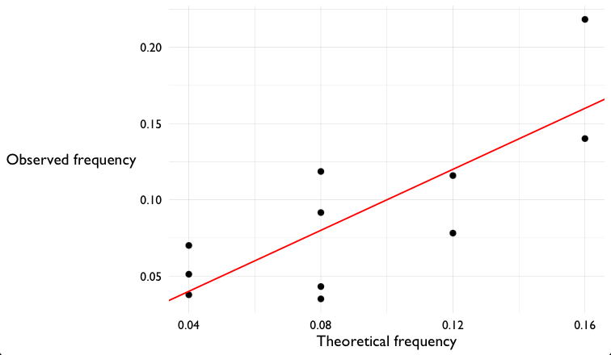

# Sanity check!

Another good idea is to check whether our model really fits the data.

Here's a good way to do that - plot theoretical versus observed frequencies.

```r
observed_frequencies = (
	full_data
	%>% group_by( sum_of_dice )
	%>% summarise(
		n = n(),
		frequency = n / nrow( full_data )
	)
)

theoretical_frequencies = two_dice_likelihood(
	2:12,
	die_model = c( 0.2, 0.2, 0, 0.2, 0.2, 0.2 )
)

print( observed_frequencies )
print( theoretical_frequencies )
```

Let's plot them:
```r
p = (
	ggplot(
		data = (
			theoretical_frequencies
			%>% inner_join( observed_frequencies, by = "sum_of_dice" )
		)
	)
	+ geom_point( aes( x = probability, y = frequency ))
	+ geom_abline( slope = 1, col = 'red' )
	+ xlab( "Theoretical frequency" )
	+ ylab( "Observed frequency" )
)

print(p)
```



I hope you can see that the observed frequencies are *somewhat* like the ones predicted by the model.  But there's still
a fair bit of variation.  There could be two causes:

* Maybe we're seeing sampling variation (if we generated more samples, maybe it would start to look more similar).  Or
* Maybe the real dice really are different to the model, we just haven't detected it yet!

To look for the latter we'll go and compute a P-value next.

