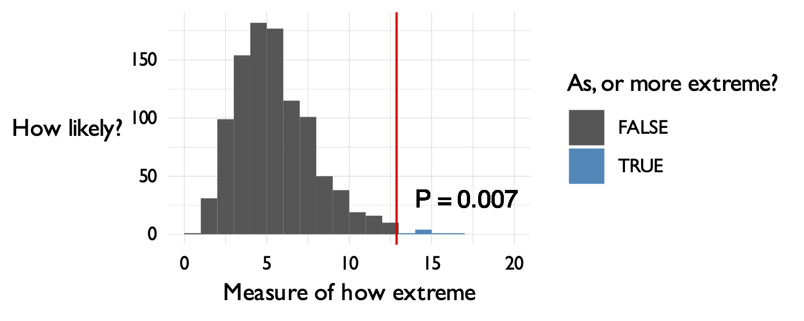

# Frequentist intermission: the p-value

In the earlier part of this model we used a bayesian analysis to select a favourite mode of our dice.  Our analysis suggested that probably, the dice was covered up so that the number '3' never turned up on either die.

In this section we will instead use a P-value to test whether our favourite model actually matches the real data.  Or
maybe the real dice don't quite act like this model?

The P-value is a good choice here because it's simpler than the Bayesian analysis in one sense.  We don't have to choose
what the possible other models are, or how good they are - we just ask how likely the data are if our model is
true.

:::tip P-value

If the assumed model were true, how likely would it be to get a result as extreme (or more extreme) than the one we observed 'by chance'?

:::

P-values are often thought of as coming from the *frequentist* way of thinking.  That is, you imagine that we could
re-run the experiment a large numbers of times, with exactly the same setup.  What proportion of times would we see such
an extreme result?

(However, there's nothing particularly frequentist about the above definition, which could also be just regarded as a
statement about the model - no repeat experiments needed.)

For example, here's a P-value being computed from a distribution of results obtained under repeated experiments - about 0.7% of the experiments showed such an extreme result as the observed data:



:::caution Watning

As the x axis label shows - to compute a p-value you need something to measure that captures the idea of how 'extreme'
the model is.  Fortunately there is a sensible standard choice for this - the **likelihood ratio** that we'll use
below.
:::


:::tip Terminology

The model being used in a P-value calculation is commonly referred to as the 'null' model.  So we could equally write:

**P-value** = the probability of seeing such a result as or more extreme then we observed, **if the null model were true**.

:::

## Example: are our dice really like the model?

In our example we have data from real dice with blu-tack stuck on.  If you believed our [bayesian
inference](./bayesian.md) our chosen model is that 3 never turns up, and that all the other numbers turn up with equal probability ($20\%$, since there are 5 other numbers).

Of course the *real* dice could still behave differently to this model.  After all, Who knows what that does to the
dynamics of the dice rolls?

To test whether the real dice differ from the model let's compute a P-value.  We'll follow the frequentist way of
thinking and work like this:

* We'll simulate lots of datasets from our null model;
* We'll compute a number measuring how well our model fits the data, for each simulated dataset;
* and then we'll compare that to the observed value to compute a P-value

### Computing the log-likelihood ratio

It turns out that a good measure of 'how well our model fits the data' is given by a *log-likelihood ratio*.  This
specifically measures how much better the 'best possible' model fits, compared to the 'null' model we are using.  (So
larger log-likelihood ratios mean our model is worse.)

In our case, the 'best possible' model is one that perfectly matches the data frequencies.  For example, if the
real data were $4, 12, 5, 5$ then the best model would have $P(4) = P(12) = 25\%$, $P(5) = 50\%$, and $P(\text{anything
else}) = 0$.  Here is a function that computes the log-likelihood under the best-possible model, learnt from the data:

```r
best_possible_loglikelihood <- function( observed ) {
	(
		tibble::tibble( sum_of_dice = 2:12 )
		%>% mutate(
			# This line counts occurences of 2-12 in the data:
			count = sapply( sum_of_dice, function(i) { sum( observed == i ) }),
			# This line gets their frequencies:
			frequency = count / length(observed),
			# This line finds the log-likelihood contribution.
			# The likelihood contribution is frequency^count, but we work in log space
			ll = count * log(frequency)
		)
		%>% summarise( ll = sum( ll, na.rm = T ))
		# This line turns it back from a data frame into a number:
		%>% pull( ll )
	)
}
```

For example:
```r
best_possible_loglikelihood( c( 4, 12, 5, 5 ))
```
produces $-4.16$, that is, the likelihood is $e^{-4.16} = 0.0156$.  This is as it should be, since $0.0156 = 0.25 \times 0.25 \times 0.5 \times 0.5$.

:::tip Note

Run the function on our data now:
```r
best_loglikelihood = best_possible_loglikelihood( data$sum_of_dice )
```

What's the value computed?  Is it roughly what you expect?

**Remember** probabilities lie between 0 and 1, so log probabilities lie between $-\infty$ and $0$.  Also, remember that
the probability of any specific sequence of outcome results is likely to be **very small indeed**, since there are so
many possible outcomes.
:::

To compare our model log-likelihood to this one is simple.  We'll compute the likelihood ratio:

$$
\text{Likelihood ratio} = \frac{P(\text{data}|\text{best model})}{P(\text{data}|\text{our model})}
$$

or rather, since we are working in log space, the log likelihood ratio:

$$
\log(\text{likelihood ratio}) = \log P(\text{data}|\text{best model}) - \log P(\text{data}|\text{our model})
$$

:::tip Log likelihood ratio

Compute the log-likelhood ratio now:
```r
null_model = c( 0.2, 0.2, 0., 0.2, 0.2, 0.2 )
null_loglikeihood = total_loglikelihood( data$sum_of_dice, our_model )
log_likelihood_ratio = best_loglikelihood - null_loglikeihood
```
:::

Look at the values.  You should see that the **the data is substantially more likely under the best possible model than it is under our chosen model**.  (Of course it is, because the best model is allowrd to fit the frequencies in the data exactly). And therefore the log likelihood ratio is positive.  

In these data, it's about $4.9$, so the data are about $e^{4.9} = 134$ times as likely given the best model than the null model.

For our purposes, let's use this number - the log likelihood ratio - as a way to measure 'as or more extreme' for a P-value calculation.  In short, we'll say larger log-likelihood ratios are more extreme (in the sense that they indicate a less good fit of our null model to the data) and look to see how likely our observed value $4.9$ was to appear by chance.

### Computing the P-value by simulation

To compute a P-value is now easy.  We'll simulate a thousand datasets from the null model (or favourite dice model) and
then we'll see how surprising the the log-likelihood ratio we saw above was in each of the simulations.

Let's do that now.  First let's make sure you have our `simulate_two_dice()` function from the [earlier section](./unfair.md).

```r
simulate_two_dice <- function(
	number_of_times,
	probabilities = rep( 1/6, 6 )
) {
	die1 = sample( 1:6, size = number_of_times, replace = T, prob = probabilities )
	die2 = sample( 1:6, size = number_of_times, replace = T, prob = probabilities )
	return( die1 + die2 )
}
```

Here's a function to do the simulation:
```r
simulate_ll_ratios = function(
	data,
	null_model = c( 0.2, 0.2, 0, 0.2, 0.2, 0.2 ),
	number_of_simulations = 1000
) {
	# Create a place to put results:
	result = tibble::tibble(
		simulation        = 1:number_of_simulations,
		best_model_ll     = NA,
		null_model_ll      = NA
	)

	# Loop over simulations
	for( i in 1:nrow( result )) {
		# Simulate the dice
		simulation = simulate_two_dice( nrow( data ), null_model )
		# Compute the 'best' model log-likelihood in the simulated data
		result$best_model_ll[i]  = best_possible_loglikelihood( simulation )
		# Compute the 'null' model log-likelihood in the simulated data
		result$null_model_ll[i]  = total_loglikelihood( simulation, null_model )
	}

	# Add the ll ratio, and return.
	(
		result
		%>% mutate(
			ll_ratio = best_model_ll - null_model_ll
		)
	)
}
```

Let's run it:
```r
simulation = simulate_ll_ratios( data, number_of_simulations = 10000 )
```

...and let's use that to compute the P-value as the **fraction of simulations that have log-likelihood ratio as extreme, or more extreme than the one we observed**:
```r
observed_ll_ratio = best_possible_loglikelihood( data$sum_of_dice ) - total_loglikelihood( data$sum_of_dice, our_model )
p_value = length( which( simulation$ll_ratio >= observed_ll_ratio )) / nrow( simulation )
sprintf(
	"++ The p-value is: %.5f",
	p_value
)
```

Finally, let's plot the distribution to see what it looks like:
```r
p = (
	ggplot( data = simulation )
	+ geom_histogram(
		aes(
			x = ll_ratio,
			fill = (ll_ratio >= observed_ll_ratio )
		),
		binwidth = 0.5
	)
    + geom_vline( xintercept = observed_ll_ratio, col = 'red' )
	+ geom_text( x = observed_ll_ratio + 0.5, y = 50, label = sprintf( "P = %.2g", p_value ), hjust = 0)

	# Add some cosmetic tweaks:
	+ mytheme()
	+ scale_fill_manual(
		values = c( '#555555', '#2288bb' ),
		name = "Simulated data\nas or more extreme?"
	)
	+ xlab( "log(likelihood ratio)" )
	+ ylab( "Number of\nsimulations" )
)
print(p)
print(p_value)
```

:::tip Note

Small P-values mean that data this extreme was pretty unlikely under the null model.  Large P-values mean that they are plausible.

How likely was it to see data this extreme **by chance** if our model was true?

:::

## Challenge question: adding more data

:::tip Question

What happens if you try this with more data?   E.g. Try applying this to the full dataset:
```r
full_data = readr::read_tsv( "https://users.ox.ac.uk/~whgu0376/training/msc_gm/2026/data/dice_data_full.tsv" )
```

Repeat the above analysis and work out:

* What's your **formal (statistical) interpretation** of the result?
* What's your **scientific interpretation** of this result?
* is there any evidence that the real dice differ from our model now?

**Note**. You may have to turn up the number of simulations to get a sensible answer.

:::
