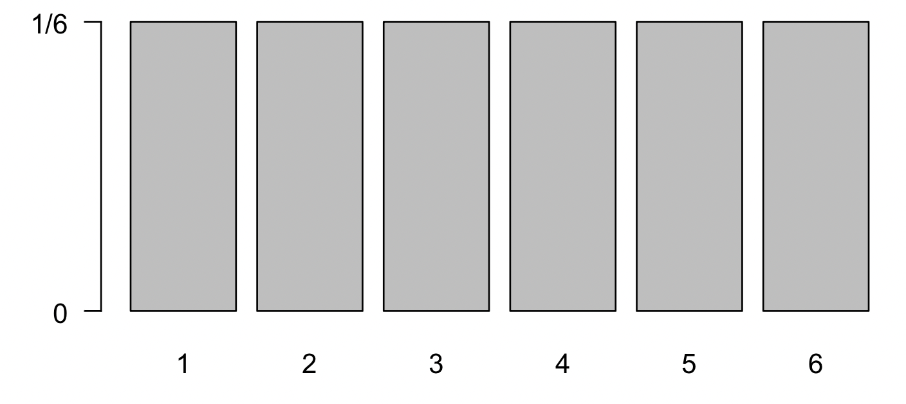
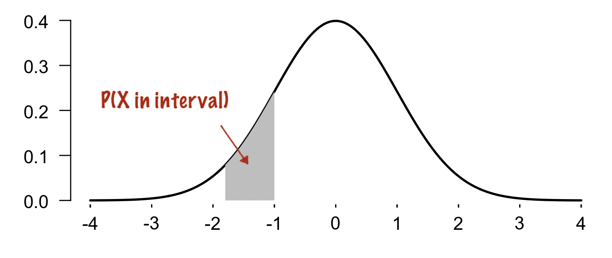

# Distributions

In statistics, the way uncertainty is accounted for is through  **probability distributions**.  

Suppose we are interested in a variable $X$.  A distribution for $X$ is just a function that distributes a total of 100%
probability 'mass' over the possible values of $X$.  More formally:

:::tip Definition

A distribution for $X$ is a function that assigns a probability (or density) to each value of $X$.
**It must sum (or integrate) to $1$, over all possible values of $X$.**

:::

For example, here is the distribution of the roll of a normal 6-sided die:

The die has $6$ possible outcomes $X=1,\cdots,6$, and the function assigns probability mass $\tfrac{1}{6}$ to each of them.  Across all possibilities it adds up to $1$ (i.e. $100\%$ total probability.)  Simple, right?

For a continuous variable $X$ things are *slightly* more complicated because to get an actual probability we typically have to think in terms of *ranges* of values.  For example, here is the density of a normal distributed variable:

Like the dice example, the function sums to $1$ over the whole real line.  As shown on the plot, to read off the probability that $X$ is in any given part of its range, we just sum up (integrate) the density over the range.  (So the density function itself isn't returning a probability at each point - the probability of any specific value is vanishingly small) - but something that sums up to a probability over any range of values).

## Warm-up exercise

It's instructive to calculate simple distributions by hand - let's warm up with an exercise:

:::tip Exercise

**What is the distribution of the sum of two dice rolls?**

You should work this out using a pen and paper!

1. Start out with an empty graph.
2. Label the X axis with all the possible values you could get $2, 3, ..., 12 $
3. The number of ways to get a $2$ is of course... one!  Draw a bar of height 1 at $2$.
4. ...complete the picture.

Is what you've drawn a distribution?  **Hint** a distribution must sum to $1$ over all the possible values of $X$.

:::
