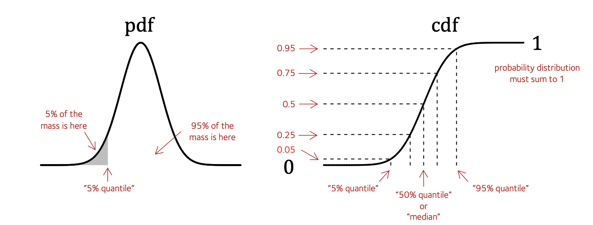

# Density, cumulative probability, and quantiles

The distribution functions in $R$ come in groups that differ by their first character - 'd', 'p', 'q', and 'r'.

* `d<name>()` the *probability* or *probability density* function
* `p<name>()` the *cumulative density* function, that you get by adding up values of the density.
* `q<name>()` the *quantile* function, that is the inverse of the cumulative density.
* `r<name>()` that sample random values from the distribution.

This page describes the first three of these.  For example, here is a picture of a normally distributed variable $X$:

I've annotated this with various pieces of information.

On the **left** is shown the *probability density function* or **pdf** which you [plotted already](./normal.).  You could compute this using `dnorm()` in R as we did [on this page](./some_distributions.md).

To fix terminology I've labelled a particular point on the X axis - the $5\%$ quantile.  That means: the value $x$ such that **exactly 5% of the mass of the distribution is $\leq x$**.

On the **right** is shown the *cumulative density function* or **cdf**.  You can compute using `pnorm()` in R.
The cdf is just worked out by summing up (that is, *integrating*) the area under the pdf from left to right.

:::note Note
Since this is a distribution, the **total area under the distribution is $1$**. That means the cdf must asymptote to $1$ on the right - look, it does!
:::

## Quantile levels

As the red annotations indicate, the cdf is the function that maps values of $X$ and tells you which **quantile** they
correspond to - i.e. **how much mass is to the left of them**.  For example:

:::tip Question

For a normal distribution with mean 10 and standard deviation 3, how much of the probability mass is $\leq X=1$?

**Hint** use `pnorm()`!
:::

## Finding quantiles

You might also want to go the other way: that is, finds the **value of $X$** that corresponding to a given quantile -
e.g. the value of $X$ that has at least 5%, or 25% mass to the left of it.

This is the job of the **quantile function**.  The quantile function is just the inverse of the cdf (it maps the y axis
values back to the x axis).

:::tip Question

Use `qnorm()` to answer: For a standard normal distribution (with mean 0 and standard deviation 1), what's the 2.5% quantile at?

**Hint**. Again, the help page might help.  `qnorm()` uses the name `p` for the choice of quantile, eg. `p=0.025` in the above.

How does the 2.5% quantile change as you change the standard deviation?

:::

