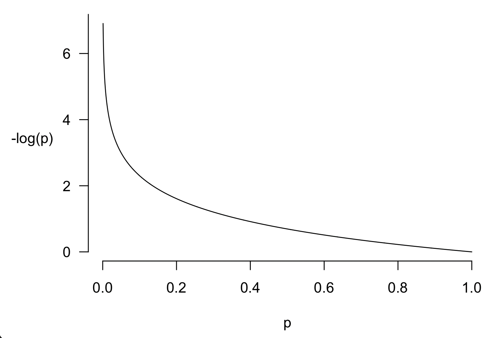

import Tabs from '@theme/Tabs';
import TabItem from '@theme/TabItem';

# Summary statistics

We can also handle distributions by creating some single-number **summaries** of the distributions.

If $P(x)$ is a distribution function, here are a few commonly encountered summaries:

| Name | Symbol | Description | Expression |
| ---- | ------ | ---------- | ----------- |
| **Mean** | $\text{mean}()$ | Average (or mean) **value**<br /><small>Where are the values located?</small><br/><small>Also known as 'expected value' or 'expectation'</small> | $\sum_x P(x)\cdot x$ |
| **Variance** | $\text{var}()$ | Average **squared distance to mean**<br /><small>How spread out are the values?</small> | $\sum_x P(x)\cdot (x-\mu)^2$<br /><small>where $\mu = \text{mean}(X)$</small> |
| **Entropy** | $H()$ | Average negative log probability<br /><small>average 'uncertainty', or</small><br /><small>average amount of 'information' in a value of $X$</small> | $-\sum_x P(x) \cdot \ln\left(P(x)\right)$  |

What you'll note about these summaries is that they all have the **same form**.  They are all **averaging** some quantity over all possible values of $X$, **weighted by the probability**.  The quantity averaged is either:

* The value itself, leading to the mean or average value;
* The (squared) distance of the value to the mean, forming the variance.  This is a measure of how 'spread out' the
  distribution is, in this particular 'squared distance' sense.  If most of the likely values are close together (i.e.
  we are relatively certain about the value), the variance will be low, but if the probability mass is spread out a lot
  then the variance will be high.
* Or (minus) the logarithm of the probability itself, forming the entropy.  This is another measure of how 'uncertain'
  the distribution (described further below).  We won't make much use of it in this course but you may come across it.

(There is also the **standard deviation**, which is the square root of the variance, and the **median**, which is the value that has half the probability mnass on one side and half on the other.  Neither of these are averages in the same way, though.)

:::tip Challenge

On the [previous page](./distributions.md) you computed the distribution of the sum of two dice rolls.

Now compute the **mean**, the **variance**, and the entropy.

**Question**. What will happen to these values if you move some of the mass - for example, moving $1/6$th of the mass away from the
center to one of the other numbers? (Remember the distribution has to sum to one.)

<Tabs groupId="style">
<TabItem value="yourself" label="Do it yourself">

Can you try this?  (I suggest working in R!)

</TabItem>
<TabItem value="hint" label="Hint">

For example, I happen to like data frames, so I might choose to store the distribution in a data frame:

```r
library( tidyverse )
distribution = tibble(
	sum_of_dice = 2:12,
	p           = c( 1:5, 6, 5:1 ) / 36
)
```

You could plot this to check it's right:
```r
library( ggplot2 )
(
	ggplot( data = distribution )
	+ geom_col( aes( x = sum_of_dice, y = p ))
)
```

And then use somehing like [`summarise()`](https://dplyr.tidyverse.org/reference/summarise.html) to compute the summaries.

</TabItem>
<TabItem value="solution" label="Solution">

Using [tidyverse](https://tidyverse.org)-style programming - you could put the distribution in a data frame, and compute
the summarise you could use the `summarise()` function:

```r
distribution = tibble(
	sum_of_dice = 2:12,
	p           = c( 1:5, 6, 5:1 ) / 36
)

(
	distribution
	%>% summarise(
		mean     = sum( p * sum_of_dice            ),
		variance = sum( p * (sum_of_dice - mean)^2 ),
		entropy  = sum( -p * log(p)                )
	)
)
```

Nice!
```
# A tibble: 1 × 3
   mean variance entropy
  <dbl>    <dbl>   <dbl>
1     7     5.83    2.27
```

Now move some of the mass by changing the values in `distribution` (making sure they sum to $1$) and recompute.

</TabItem>
</Tabs>


:::

## Understanding variance

Variance is a measure of how 'spread out' a distribution is (around its mean).  It measures the *average squared distance* of values to the mean.

If a lot of the mass of distribution is far from the mean (i.e. the distribution is 'spread out'), the variance will be large.  While if most of the values are close to the mean, the variance will be small.

:::tip note

Why 'squared distance' instead of something else, like 'absolute distance' here?  There's nothing to stop you measuring 'spread-outiness' by some other mechanism, like the absolute distance to the mean.  

One reason to focus on variance, however, is that it corresponds well to the variation of variables that are normally
distributed.  And as it turns out, most variables are approximately normally distributed (if they summarise lots of
data) so that this is often the natural choice.

Variance sometimes turns up as **standard deviation** (which measures exactly the same thing - it is just the square
root of the variance).  The advantage of the standard deviation is that it is on the same 'scale' as the variable $X$
itself (so that, for example, it doubles if you double $X$).  The variance doesn't have this property but in other ways
is simpler - that is, both are useful ways to express this quantity.

:::

## Understanding entropy

We won't make much use of entropy in this course, but here is an explainer in case you are interested.

One way to think of the entropy is like this.  Imagine we draw a value $X=x$ from the distribution.  Suppose we measure
how 'surprising' this value is as the negative logarithm of its probability:

$$
\text{surprisingness}(x) = -\log P(X=x)
$$
The entropy is just the *average surprisingness*:
$$
H(X) = \sum_x P(X=x)\cdot\text{surprisingness}(x)
$$

Why is this a sensible definition of "surprisingness"?  Well, here is a graph of $p \mapsto -\log(p)$:


Note that:
* When $p$ is large (close to $1$), then $-\log(p)$ is close to zero. This matches the fact that observing a value that is very likely, is **not very surprising**.

* On the other hand when $p$ is small (close to $0$), then $-\log(p)$ gets very large - in fact it goes to $+\infty$ at $0$. 
This matches the fact that observing a value that is very *un*likely, is **very surprising**.  (Infinitely surprising if actually had zero probability.)

Although I've called this 'surprisingness' above, another way to think of it is 'average information provided by an observation'  If the distribution is already very concentrated on one of a few values - i.e. entropy is low - we don't learn much about $X$ by observing it.  On the other hand if the distribution is very spread-out - i.e. entropy is high -  we learn a lot about $X$ by observing it.

The entropy, which is the average of $-\log(p)$, can therefore be thought of as the average surprisingness of an observation or the average amount of information added by an observation.

**Information and uncertainty are two sides of the same coin.**

:::tip Example

Imagine a distribution where all $100\%$ of the mass is on one value, so we are already completely certain about the value of $X$.  The logarithm of $1$ is $0$, so in this case the entropy works our as

$$
H(X)= -1 \times 0 = 0
$$

So entropy = 0 corresponds to the situation of 'no uncertainty'.

to the case where all the values $2,\cdots,12$ have the same probability $\tfrac{1}{11}$, so that we are, so to speak, 'completely uncertain' about the value of $X$.  Then the entropy is

$$
H(X) = -\sum_2^{12} \tfrac{1}{11}\cdot \ln\left(\tfrac{1}{11}\right) = -\ln\left(\tfrac{1}{11}\right) \approx 2.4
$$

Like the variance, the **entropy gets bigger** as the probabilty mass gets more spread out - higher entropy means more uncertainty.

:::