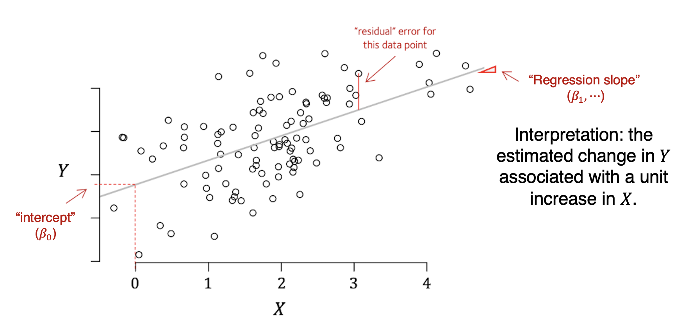

# Interpreting regression output

Whichever [flavour](./forms_of_regression.md) of regression you run, you'll get output looking like a big table of
numbers, something like this:

```r
# A tibble: 3 × 5
  term             estimate std.error statistic  p.value
  <chr>               <dbl>     <dbl>     <dbl>    <dbl>
1 (Intercept)       -0.0147    0.0224    -0.658 5.12e- 1
2 my_X_variable      0.239     0.0299     7.99  2.82e-12
3 another_variable   0.0342    0.0201     1.70  9.22e- 2
```

How should we interpret that?

In one sense, interpreting these results is the **same for all regression models**.  For example, here we see that:

* The estimated association between $X$ and the $Y$ variable is $0.239$;
* The estimated *standard error*, which reflects how uncertain the model is about the estimate, is $0.0299$;
* And, as a result, the P-value (which reflects "how likely such a big estimate was if there were no true association" )
  is pretty small in this example - $\text{p-value} = 2.8\times 10^{-12}$.

(In other words, such a strong association seems vanishingly unlikely 'by chance'.)

However, the differences between regression models come when you want to interpret the estimates in terms of the
original variable $Y$.  This is because of the different link functions used for the different types of regression,
which means that the linear predictor (and so the parameters) are on different scales.

Here is a quick rundown and then a description.

|                    | Linear             | Logistic                | Poisson        |
| ------------------ | ---------          | ---------               | -------------- |
| $Y$ represents:    | A continuous value | A binary $0/1$ variable | A count, e.g. of events |
| Intercept<br/><small>or "baseline"</small><br/>parameter          | Estimated **mean of $Y$**<br/><small>when all other predictors are $0$</small> | Estimated **log-odds of $Y$**<br/><small>when all other predictors are $0$</small> | Estimated **log of rate of $Y$**<br/><small>when all other predictors are $0$</small> | 
| Other parameters   | Estimated **change in $Y$**<br/><small>for unit increase in predictor</small> | Estimated **change in log-odds of $Y$**<br/><small>for unit increase in predictor</small> | Estimated **change in $\log(\text{rate})$ of $Y$**<br/><small>for unit increase in predictor</small> |

I hope you see the pattern here - it's similar for each model, and interpretable as long you know the
appropriate scale.

## Interpretaiton in specific models

### Linear regression

For linear regression, the "link" function is just the identity function, $y=x$, and so the estimates are on the same
scale as $Y$.  The parameter interpretation is:

**Intercept**: "the estimated mean value of $Y$, when all the other predictors are $0$.".

**Other parameters**: "the estimated change in $Y$ associated with a unit increase in the predictor".

But this is probably easier to remember using a picture:



The picture shows what is going on - the linear regression model tries to find a line of 'best fit' between the
predictor variables and $Y$, and the parameters are the parameters of this line.  (If there are more than one $X$
variable, it becomes multi-dimensional, so it's a 'plane' rather than a line.)

### Logistic regression

For logistic regression, there's a nontrivial link function to worry about.  In short, the logistic function
$$
\text{logistic}(x) = \frac{e^x}{1+e^x}
$$

is used to map the linear predictor, which is on the log-odds scale, to a probability, which is then used in the
binomial distribution.  Here it is again:


To understand this, let's try going the other way, from a probability $p$ to the predictor scale.  It works like this:
first, convert the probability to an odds:

$$
\text{odds}(p) = \frac{p}{1-p} \qquad\text{(this lies in the range $[0, \infty]$)}
$$
and then take a logarithm to get it in the range $(-\infty, \infty)$:
$$
\text{logodds}(p) = \log\left( \frac{p}{1-p}\right) \qquad\text{(this lies in the range $[-\infty,\infty]$)}
$$

This probability-to-logodds mapping looks like this:


In the regression model terminology this is the **link function**, and the logistic function is its inverse.


In a sense, log-odds is just a useful way of representing a probability - as something that can take any real number
value.  To get back to a probability back you use the logistic function.

What this means for the regression result is:

The **intercept** is interpreted as: the modelled log-odds of $Y$, when all the other predictors are $0$; and

The **other parameters** are interpreted as: "the change in log-odds, or **$\log\left(\text{odds ratio}\right)$**, associated with a unit increase in the predictor."

Easy?

### Poisson regression

For Poisson regression, there's also a nontrivial link function to worry about - the logarithm function. It maps the
Poisson rate parameter, which is positive, onto $\log(\text{rate})$.  This is helpful, because $\log(\text{rate})$ lies
in $[-\infty, \infty]$.

The inverse of $\log()$ is the exponential function, which looks like this:


The rate is therefore modelled as $\exp()$ of the linear predictor.  To go back from the rate to the linear predictor again,
you use $\log()$.

This means that:

The **intercept** is interpreted as: the modelled $\log()$ of the rate, when all the other predictors are $0$; and

The **other parameters** are interpreted as: "the change in $\log(\text{rate})$ associated with a unit increase in the predictor."
