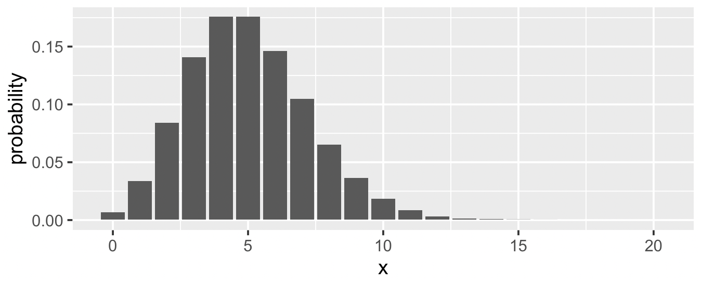

# Example: poisson regression

Another example is poisson regression, which is useful if $Y$ is a count variable, like the count of events -
infections, occuring over a fixed period of time.  To handle this, it models $Y$ using a [Poisson
distribution](https://en.wikipedia.org/wiki/Poisson_distribution).

The key parameter of the Poisson distribution is the *rate*, or the average number of events in the given time period. For example if an average of $5$ events appear in the given time period, the Poisson distribution models event counts like this:
```r
library( tidyverse )
library( ggplot2 )
ggplot(
	data = tibble::tibble(
		x = 0:20,
		probability = dpois( x, lambda = 5 )
	)
) + geom_col( aes( x = x, y = probability ))
```

...and looks like this:



The rate of events is of course a non-negative number.  So, to model this, poisson regression typically uses the
**exponential function** to map the linear predictor

$$
\text{"linear" predictor} = \beta_0 + \beta_1 X_1 + \beta_2 X_2 + \cdots
$$
onto a non-negative rate,
$$
\text{rate} = \text{average number of events} = e^{\text{linear predictor}}
$$

The inverse function, known in regression terminology as the **link function**, is of course the logarithm

$$
\text{linear predictor} = \log(\text{rate})
$$

Fitting Poisson regression is also easy.  For example, here's a simulated dataset from an infectious disease vaccine trial:
```r
simulated_data = tibble::tibble(
	vaccination_status   = sample( c(0,1), 100, replace = TRUE ),
	another_variable     = rnorm( 100, sd = 1 ),
	number_of_infections = rpois( 100, lambda = exp( 1 - 0.5 * vaccination_status + 0.25 * another_variable ))
)
```

```r
broom::tidy(
	# Fit the model
	glm(
		# Model formula
		number_of_infections ~ vaccination_status + another_variable,
		# Model data
		data = simulated_data,
		# Model Y using this distribution:
		family = "poisson"
	)
)
```

which gives:
```r
# A tibble: 3 × 5
  term               estimate std.error statistic  p.value
  <chr>                 <dbl>     <dbl>     <dbl>    <dbl>
1 (Intercept)           1.09     0.0799     13.7  1.48e-42
2 vaccination_status   -0.693    0.143      -4.85 1.21e- 6
3 another_variable      0.222    0.0601      3.69 2.21e- 4
```

This is again a **maximum likelihood** fit - it finds the parameters which maximise the probability of the count data
given the predictors.  And the estimate is - well, not 100% accurate, but *not bad*.  (At least, it's within two standard errors, which is often all we can hope for.)

Fitting a poisson regression is therefore just as easy as [linear](./regression.md) and
[logistic](./logistic_regression.md) regression. 

:::warning Warning!

To interpret what the parameters mean, you of course have to remember that the link function is here.  The linear predictor for poisson regression is 'log' space - it's the logarithm of the underlying rate parameter. 

We'll [describe parameter interpretation in more detail on the next page](./interpreting_regression.md).

:::
