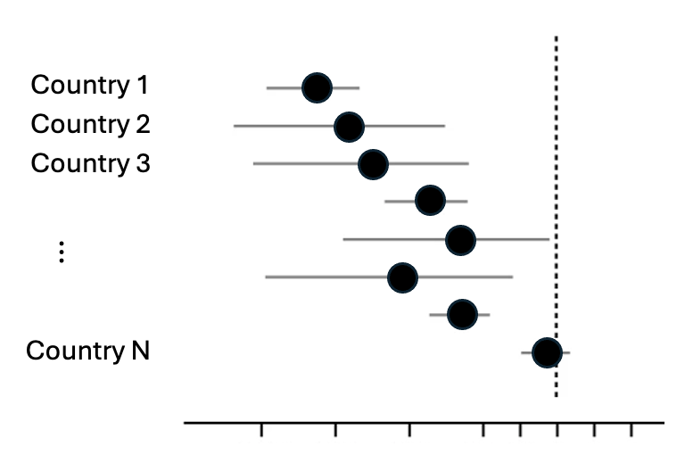

# 6. Forest plot them across populations

If O blood group were really protective, we might hope to see the same association turning up in different countries /
study sites in the data.  IN other words we might expect to see **internal replication**.

Let's try now by making a **forest plot** showing the effect sizes and confidence/credible intervals across populations.

It turns out there's a really easy way to do the computation using another `dplyr` data verb - `reframe()`.  It goes like this:
```r
(
	abo_data
	# group_by() the country - this is a bit like looping over them:
	%>% group_by( country )
	# reframe() is a bit like summarise(), but the function can return a whole data frame
	%>% reframe(
		broom::tidy(
			glm(
				status ~ rs8176719_recessive,
				family = "binomial",
				data   = pick( everything() )    # Funny syntax that means 'put the current group of data in'
			) 
		)
	)
)
```

Wow!  That is a wonderful, wonderful thing.

If O blood group were really protective, we might hope to see similar levels of association in different countries.

:::tip consistency

Look at the estimates and decide if you do?

:::

To really get a sense of this it would be much nicer to make a plot.  Let's do that now - we'll make a forest plot.

:::tip Challenge

Use `ggplot` to make a **forest plot** of the association across populations.  It should show:

* one estimated effect per row (each row is one country).
* the estimate should be shown as a point.
* the 95% interval should be shown as a thin horizontal line segment.
* the row should be labelled with the country name.
* and you should add a vertical line at the right place to mean 'no effect'.

So it'll look something like this:



For extra kudos think carefully about how to encode the x axis.  Should it be on the log-odds scale that the parameter
is on?  Or should it be on the odds ratio scale?  *Or*, perhaps it could be on the odds ratio scale, but visually
transformed using `scale_x_log()` so that the intervals become symmetric again.  You choose!

For *maximum* kudos, give it good axis labels and consider the amount of data ink (a [useful guideline](https://www.edwardtufte.com/book/the-visual-display-of-quantitative-information/) is to maximise the amount of ink on the plot that shows useful data).

(And maybe you want to annotate the O blood group frequencies?  Sample sizes?  P-values?  Go for broke!)

:::


